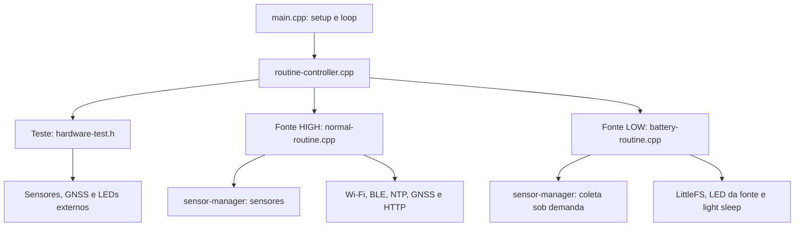

# Índice

- [Instalação do PlatformIO e uso](#instalacao)
- [Funcionamento geral e diagrama](#funcionamento)
- [Configuração dos LEDs e pinagem](#leds)
- [Economia de bateria e limites físicos](#bateria)
- [Armazenamento e retorno da fonte](#armazenamento)
- [Validação e testes](#validacao)
- [Atualizações e changelog](#changelog)
- [Descrição de cada arquivo](#arquivos)

<details>
<summary><strong>Índice clicável de todos os arquivos do projeto</strong></summary>

| Arquivo | Função |
| --- | --- |
| [.github/workflows/firmware.yml](.github/workflows/firmware.yml) | Compilação e testes automáticos |
| [.gitignore](.gitignore) | Arquivos fora do Git |
| [.vscode/extensions.json](.vscode/extensions.json) | Extensões recomendadas |
| [README.md](README.md) | Guia do firmware |
| [include/README](include/README) | Pasta de headers compartilhados |
| [lib/README](lib/README) | Pasta de bibliotecas locais |
| [platformio.ini](platformio.ini) | Placa e dependências |
| [scripts/run-host-tests.sh](scripts/run-host-tests.sh) | Executa os testes sem placa |
| [src/api/api.cpp](src/api/api.cpp) | Arquivo reservado da API |
| [src/api/json-builder.cpp](src/api/json-builder.cpp) | JSON enviado ao backend |
| [src/api/json-builder.h](src/api/json-builder.h) | Interface de serialização |
| [src/bluetooth/ble-callbacks.h](src/bluetooth/ble-callbacks.h) | Callbacks NimBLE |
| [src/bluetooth/ble-manager.cpp](src/bluetooth/ble-manager.cpp) | Provisionamento BLE e fragmentação |
| [src/bluetooth/ble-manager.h](src/bluetooth/ble-manager.h) | Interface do transporte BLE |
| [src/bluetooth/ble-uuid.h](src/bluetooth/ble-uuid.h) | Identificadores do serviço BLE |
| [src/config/config.h](src/config/config.h) | Pinagem e parâmetros gerais |
| [src/config/settings-manager.cpp](src/config/settings-manager.cpp) | Persistência de configurações no NVS |
| [src/config/settings-manager.h](src/config/settings-manager.h) | Interface das configurações persistidas |
| [src/device/device-identity.cpp](src/device/device-identity.cpp) | Identificador derivado do ESP32 |
| [src/device/device-identity.h](src/device/device-identity.h) | Interface do identificador de hardware |
| [src/hardware-test.h](src/hardware-test.h) | Diagnóstico físico dos sensores e LEDs |
| [src/led/status-leds.h](src/led/status-leds.h) | LEDs externos e ajuste de brilho |
| [src/location/location-manager.cpp](src/location/location-manager.cpp) | Busca, persistência e envio de posição |
| [src/location/location-manager.h](src/location/location-manager.h) | Estado da localização da estação |
| [src/location/location-schedule.h](src/location/location-schedule.h) | Agenda monotônica de GNSS |
| [src/main.cpp](src/main.cpp) | Seleciona o modo e delega rotinas |
| [src/network/station-http-client.cpp](src/network/station-http-client.cpp) | Requisições autenticadas da estação |
| [src/network/station-http-client.h](src/network/station-http-client.h) | Interface das requisições HTTP |
| [src/network/wifi-manager.cpp](src/network/wifi-manager.cpp) | Conexão e encerramento do Wi-Fi |
| [src/network/wifi-manager.h](src/network/wifi-manager.h) | Interface de rede Wi-Fi |
| [src/power/power-manager.cpp](src/power/power-manager.cpp) | Controle de energia do ESP32 |
| [src/power/power-manager.h](src/power/power-manager.h) | Interface de alimentação e repouso |
| [src/protocol/protocol-handler.cpp](src/protocol/protocol-handler.cpp) | Comandos de configuração da estação |
| [src/protocol/protocol-handler.h](src/protocol/protocol-handler.h) | Interface dos comandos BLE |
| [src/routines/battery-routine.cpp](src/routines/battery-routine.cpp) | Economia e gravação local |
| [src/routines/battery-routine.h](src/routines/battery-routine.h) | Estados da coleta em bateria |
| [src/routines/normal-routine.cpp](src/routines/normal-routine.cpp) | Aquisição, configuração e envio |
| [src/routines/normal-routine.h](src/routines/normal-routine.h) | Interface da rotina normal |
| [src/routines/routine-controller.cpp](src/routines/routine-controller.cpp) | Despacha teste, normal ou bateria |
| [src/routines/routine-controller.h](src/routines/routine-controller.h) | Interface do controlador |
| [src/sensors/aht20-bmp280.cpp](src/sensors/aht20-bmp280.cpp) | AHT20 sob demanda e BMP280 forçado |
| [src/sensors/aht20-bmp280.h](src/sensors/aht20-bmp280.h) | Interface de temperatura, umidade e pressão |
| [src/sensors/bh1750.cpp](src/sensors/bh1750.cpp) | Leitura de luz com power down |
| [src/sensors/bh1750.h](src/sensors/bh1750.h) | Interface do luxímetro |
| [src/sensors/gnss-manager.cpp](src/sensors/gnss-manager.cpp) | Recepção GNSS opcional |
| [src/sensors/gnss-manager.h](src/sensors/gnss-manager.h) | Dados e interface GNSS |
| [src/sensors/sensor-data.h](src/sensors/sensor-data.h) | Dados ambientais |
| [src/sensors/sensor-manager.cpp](src/sensors/sensor-manager.cpp) | Coordena barramento e sensores |
| [src/sensors/sensor-manager.h](src/sensors/sensor-manager.h) | Interface dos sensores |
| [src/sensors/sps30.cpp](src/sensors/sps30.cpp) | Protocolo de repouso do SPS30 |
| [src/sensors/sps30.h](src/sensors/sps30.h) | Interface de partículas e energia |
| [src/station/station-context.cpp](src/station/station-context.cpp) | Inicialização local e montagem da coleta |
| [src/station/station-context.h](src/station/station-context.h) | Serviços locais compartilhados |
| [src/station/station-data.h](src/station/station-data.h) | Modelo de medição da estação |
| [src/storage/pending-measurement-store.cpp](src/storage/pending-measurement-store.cpp) | Fila JSONL persistente no LittleFS |
| [src/storage/pending-measurement-store.h](src/storage/pending-measurement-store.h) | Interface das filas locais |
| [src/time/time-manager.cpp](src/time/time-manager.cpp) | Sincronização NTP na fonte |
| [src/time/time-manager.h](src/time/time-manager.h) | Interface do relógio |
| [src/time/utc-epoch.h](src/time/utc-epoch.h) | Conversão de data GPS para Unix UTC |
| [test/README](test/README) | Como ler os testes |
| [test/ble-host/Arduino.h](test/ble-host/Arduino.h) | Simulação para testes BLE |
| [test/ble-host/NimBLEDevice.h](test/ble-host/NimBLEDevice.h) | Simulação para testes BLE |
| [test/ble-host/device/device-identity.h](test/ble-host/device/device-identity.h) | Simulação para testes BLE |
| [test/ble_transport_test.cpp](test/ble_transport_test.cpp) | Testes do transporte BLE |
| [test/host/Arduino.h](test/host/Arduino.h) | Simulação para testes de persistência |
| [test/host/Preferences.h](test/host/Preferences.h) | Simulação para testes de persistência |
| [test/host/WiFi.h](test/host/WiFi.h) | Simulação para testes de persistência |
| [test/host/esp_timer.h](test/host/esp_timer.h) | Simulação para testes de persistência |
| [test/host/network/station-http-client.h](test/host/network/station-http-client.h) | Simulação para testes de persistência |
| [test/host/sensors/gnss-manager.h](test/host/sensors/gnss-manager.h) | Simulação para testes de persistência |
| [test/host/time/time-manager.h](test/host/time/time-manager.h) | Simulação para testes de persistência |
| [test/local_queues_test.cpp](test/local_queues_test.cpp) | Testes das filas locais |
| [test/location_manager_test.cpp](test/location_manager_test.cpp) | Testes da localização persistida |
| [test/location_schedule_test.cpp](test/location_schedule_test.cpp) | Testes da agenda GNSS |
| [test/measurement_configuration_test.cpp](test/measurement_configuration_test.cpp) | Testes do intervalo persistido |
| [test/routine_power_test.cpp](test/routine_power_test.cpp) | Testes das rotinas e transições |
| [test/runtime-host/Arduino.h](test/runtime-host/Arduino.h) | Simulação para testes das rotinas |
| [test/runtime-host/bluetooth/ble-manager.h](test/runtime-host/bluetooth/ble-manager.h) | Simulação para testes das rotinas |
| [test/runtime-host/hardware-test.h](test/runtime-host/hardware-test.h) | Simulação para testes das rotinas |
| [test/runtime-host/network/station-http-client.h](test/runtime-host/network/station-http-client.h) | Simulação para testes das rotinas |
| [test/runtime-host/network/wifi-manager.h](test/runtime-host/network/wifi-manager.h) | Simulação para testes das rotinas |
| [test/runtime-host/protocol/protocol-handler.h](test/runtime-host/protocol/protocol-handler.h) | Simulação para testes das rotinas |
| [test/runtime-host/station/station-context.h](test/runtime-host/station/station-context.h) | Simulação para testes das rotinas |
| [test/sensor-host/Arduino.h](test/sensor-host/Arduino.h) | Simulação para testes do SPS30 |
| [test/sensor-host/SensirionI2cSps30.h](test/sensor-host/SensirionI2cSps30.h) | Simulação para testes do SPS30 |
| [test/sensor-host/Wire.h](test/sensor-host/Wire.h) | Simulação para testes do SPS30 |
| [test/sps30_power_test.cpp](test/sps30_power_test.cpp) | Testes do repouso do SPS30 |
| [test/storage-host/Arduino.h](test/storage-host/Arduino.h) | Simulação para testes do LittleFS |
| [test/storage-host/LittleFS.h](test/storage-host/LittleFS.h) | Simulação para testes do LittleFS |

</details>

# Firmware CASA — development

Estação ambiental com ESP32-S3, AHT20, BMP280, BH1750, SPS30 e GNSS opcional. A branch `development` concentra esta reorganização; `main` permanece na versão anterior até uma futura integração.

<a id="instalacao"></a>
## Instalação do PlatformIO e uso

1. Instale o [Visual Studio Code](https://code.visualstudio.com/).
2. Abra Extensões (`Ctrl+Shift+X`), procure **PlatformIO IDE**, da PlatformIO, e instale. Aguarde a instalação inicial e reinicie o editor se solicitado. O PlatformIO Core já vem junto da extensão.
3. Instale o [Git](https://git-scm.com/downloads) se quiser acompanhar a branch. No terminal:

   ```bash
   git clone --branch development https://github.com/lucas-velocini-repo/ESP32-IT-Estacao_Meteorologica.git
   cd ESP32-IT-Estacao_Meteorologica
   ```

   Também é possível selecionar `development` no GitHub, baixar **Code → Download ZIP** e extrair.
4. No VS Code, escolha **File → Open Folder** e abra a pasta que contém `platformio.ini`. Não abra somente `src`. Aguarde o carregamento das dependências.
5. Confira a pinagem em [config.h](src/config/config.h), especialmente os LEDs e `POWER_SOURCE`. Se houver um interruptor eletrônico de alimentação GNSS, configure `GNSS_POWER_ENABLE`; o padrão `-1` significa sem controle físico instalado.
6. Escolha `TEST_MODE` em [main.cpp](src/main.cpp): `true` para diagnóstico; `false` para operação automática pela fonte.
7. Conecte a placa com um cabo USB de dados. Use **PlatformIO: Build** (ícone de verificação) e **PlatformIO: Upload** (seta). O ambiente é `esp32-s3-devkitm-1`.
8. Abra **PlatformIO: Serial Monitor**, a **19200 baud**. Se a porta não for detectada, selecione a porta em Devices ou informe-a no comando abaixo.

No terminal **PlatformIO Core CLI** do VS Code, os equivalentes são:

```bash
pio run
pio run --target upload --upload-port COM13
pio device monitor --port COM13 --baud 19200
```

Troque `COM13` pela porta exibida no seu computador; em Linux costuma ser `/dev/ttyUSB0` ou `/dev/ttyACM0`. Feche o monitor se ele estiver ocupando a porta durante o upload. Se o upload não iniciar, segure **BOOT**, pressione **RESET**, solte RESET e depois BOOT e tente novamente.

Para uma nova estação, inicie com fonte externa (`POWER_SOURCE=HIGH`) e `TEST_MODE=false`; use o aplicativo CASA para salvar identidade/token, nome, servidor e rede. A URL de ingestão deve terminar em `/measurements` (por exemplo, `http://servidor:porta/api/measurements`). Os caminhos de posição e configuração são derivados dessa URL. Credenciais ficam no NVS, não no código.

Para atualizar uma estação cadastrada, faça upload normal do firmware. Não use **Erase Flash** nem **Upload Filesystem Image**, pois podem apagar cadastro, dados ou fila. O ESP32 precisa receber um sinal de **0 ou 3,3 V** em `POWER_SOURCE`, com GND comum e sem entrada flutuante.

Referência: [instalação oficial do PlatformIO no VS Code](https://docs.platformio.org/en/latest/integration/ide/vscode.html).

<a id="funcionamento"></a>
## Funcionamento geral e diagrama

`main.cpp` apenas entrega o controle ao `RoutineController`. A variável `TEST_MODE` tem prioridade sobre a fonte. Com teste desativado, HIGH seleciona operação normal e LOW seleciona bateria. A fonte é acompanhada durante a execução e a troca ocorre após 50 ms de estabilidade, sem reinicializar o ESP32 ou reabrir o NVS.



### Rotina de testes

`HardwareTest::begin/update`, em [hardware-test.h](src/hardware-test.h), inicializa sensores e GNSS. Lê os sensores a cada 2 s e alterna **os três LEDs externos** entre vermelho, azul e ambos, com 1 s por estado. Não inicia Wi-Fi/BLE nem envia dados. A regra de apagar todos os outros LEDs na bateria vale para a rotina de bateria; o teste é uma seleção manual prioritária.

### Rotina normal

Mantém aquisição, provisionamento BLE, reconexão Wi-Fi, sincronização NTP, consulta/confirmação do intervalo remoto, posição GNSS e reenvio da fila. O intervalo padrão é **300 s (5 min)** e a última configuração persistida continua valendo.

A medição normal exige identidade, token e UTC válido. O JSON tem `device_id`, `timestamp` Unix em UTC, `latitude/longitude` opcionais, `pm`, `nc`, `typical_size`, `light`, `temperature`, `humidity` e `pressure`. PM usa µg/m³, concentrações numéricas usam #/cm³, tamanho usa µm, temperatura °C, umidade %, pressão hPa e luz lx.

A localização aceita um fix novo/recente no início e a cada 24 h. Cada busca pode durar 5 min; falha provoca nova tentativa após 15 min. A posição é salva no NVS e sua ausência não bloqueia as medições ambientais. Em bateria, só se reutiliza uma posição já armazenada da mesma identidade.

O intervalo remoto é consultado a cada 60 s por `GET /devices/config` e confirmado em `POST /devices/config/report`. Via BLE, `configure_interval` aceita 30 a 86400 s. Configurações BLE ficam persistidas e uma revisão remota antiga não as desfaz. BLE é acessível somente no normal; o teste de hardware não inicia essa pilha.

<a id="leds"></a>
## Configuração dos LEDs e pinagem

O brilho é definido em uma única função: [StatusLeds::write](src/led/status-leds.h). Edite estes valores de **0 a 255** e recompile:

```cpp
constexpr uint8_t RED_BRIGHTNESS = 48;
constexpr uint8_t BLUE_BRIGHTNESS = 20;
```

A função usa `analogWrite` em todos os modos, inclusive no teste. O projeto considera LEDs de **cátodo comum**, cada anodo com resistor próprio. PWM controla corrente média, sem substituir o resistor.

| Sinal | GPIO nos sources atuais | Função |
| --- | --- | --- |
| I2C SDA / SCL | 8 / 9 | AHT20, BMP280, BH1750, SPS30 |
| GNSS RX / TX do ESP32 | 18 / 17 | TX do GPS → RX do ESP32; RX do GPS → TX do ESP32 |
| POWER_SOURCE | 7 | HIGH: fonte; LOW: bateria |
| LED1 vermelho / azul | 4 / 5 | Conexão BLE no normal |
| LED2 vermelho / azul | 11 / 12 | Conexão Wi-Fi no normal |
| LED3 vermelho / azul | 13 / 14 | Fonte no normal; pulso vermelho na bateria |
| RGB interno | 48 | Apagado por quadro RGB preto |
| GNSS_POWER_ENABLE | -1 | Controle físico opcional, desabilitado até escolher um GPIO livre |

**A pinagem acima foi mantida do ZIP/repositório. Confira sua montagem.** Se, por exemplo, o LED azul estiver no GPIO4 em vez de GPIO5, ou seu LED2 usar GPIO10, altere as constantes em `Pins` antes de gravar.

| Modo | LED1 | LED2 | LED3 |
| --- | --- | --- | --- |
| Normal | Azul se BLE conectado | Azul se Wi-Fi conectado | Azul |
| Bateria | Apagado | Apagado | Vermelho por 1 s, apagado por 4 s |
| Teste | Vermelho → azul → ambos | Vermelho → azul → ambos | Vermelho → azul → ambos |

<a id="bateria"></a>
## Economia de bateria e limites físicos

O boot diretamente em LOW **não inicializa Wi-Fi, Bluetooth, SNTP nem a UART GNSS**. Ao sair do normal, a rotina encerra explicitamente BLE, Wi-Fi, reconexão automática, SNTP e UART antes de entrar em bateria. Uma requisição HTTP já iniciada pode terminar ou expirar antes dessa transição; novas requisições verificam a fonte.

| Componente | Comportamento em bateria |
| --- | --- |
| ESP32-S3 | CPU a 80 MHz; light sleep entre tarefas com despertar por timer ou retorno da fonte |
| Wi-Fi / BLE | Desligados, sem scan, publicidade, conexão ou envio |
| GNSS | Sem recepção/consulta UART; alimentação cortada somente se houver EN/load switch configurado |
| AHT20 | Conversão sob demanda; standby próprio entre leituras |
| BMP280 | Sleep entre coletas; medição em modo forçado na coleta |
| BH1750 | Power down; conversão única de alta resolução ao coletar |
| SPS30 | Alimentação de 5 V mantida; stop → sleep entre coletas e wake → start antes de medir |
| LEDs externos | Somente LED3 vermelho, 1 s a cada 5 s |
| RGB do ESP32 | Apagado antes de executar qualquer rotina |

### Cuidado com o SPS30

Não cortamos seus 5 V e não usamos a amostra imediatamente após religar o ventilador. Cada ciclo acorda o sensor e aguarda **30 s de estabilização**, depois aguarda a conversão BH1750 e procura uma amostra nova do SPS30 por até mais **5 s**. Se não obtiver PM, salva os demais sensores e deixa PM/concentrações/tamanho como `null`, sem copiar uma leitura antiga. Confirme suporte a campos nulos no backend usado na sua bancada.

A próxima coleta respeita o intervalo salvo, com pelo menos **30 s de repouso** após finalizar uma coleta. Portanto, na bateria intervalos muito curtos, como 30 s, são alongados para preservar estabilização e economia. O padrão de 5 min continua sendo aproximadamente 5 min entre inícios de ciclos. A primeira coleta começa ao entrar em bateria e é salva após a estabilização.

Os parâmetros estão em `BatteryConfig`, em [config.h](src/config/config.h). O fabricante recomenda pelo menos 30 s antes de usar a saída; uma média adicional de várias amostras aumenta repetibilidade, mas consome mais energia. Essa média adicional ainda não está implementada. Se o firmware do SPS30 não aceitar `sleep`, o driver registra a falha e mantém Idle após `stopMeasurement`, quando este foi confirmado. Falha em parar o sensor também é registrada e não é tratada como sucesso.

Referências: [nota de baixo consumo da Sensirion, seções 2.1 e 2.2](https://sensirion.com/en/media/documents/188A2C3C/6166F165/Sensirion_Particulate_Matter_AppNotes_SPS30_Low_Power_Operation_D1.pdf) e [datasheet SPS30](https://sensirion.com/file/datasheet_sps30).

### LEDs internos e desligamento real do GPS

O RGB endereçável do ESP32 recebe um quadro preto. No início do GNSS, o firmware envia **UBX-CFG-TP5** com TIMEPULSE desativado, para apagar o LED de fix das placas que usam esse sinal. O comportamento depende da versão do receptor e da ligação do LED; confirme na bancada.

**LEDs ligados diretamente ao VCC não têm controle por software.** Para garantir que nenhum LED da placa ESP32, GPS, UPS ou sensor permaneça aceso, retire/desconecte o LED ou seu resistor, ou interrompa sua alimentação por hardware. O firmware também não controla o instante anterior a `setup`, durante boot/reset.

Para garantir **GNSS realmente desligado na bateria**, instale um load switch/MOSFET adequado ou utilize EN, com estado elétrico padrão OFF. Configure um GPIO livre em `Pins::GNSS_POWER_ENABLE` e a polaridade `GNSS_ENABLE_ACTIVE_HIGH` em [power-manager.cpp](src/power/power-manager.cpp). Não alimente o GPS diretamente pelo GPIO e não use um pino já reservado. Com `GNSS_POWER_ENABLE=-1`, o código deixa de acessar o módulo, mas ele continua consumindo se o VCC permanecer ligado. Não é possível cumprir a condição física de todos os LEDs apagados apenas com o ZIP do firmware.

O light sleep conserva a RAM e o relógio, permite acordar na volta da fonte e evita reinicializar os sensores a cada pulso. O LEDC que sustenta o `analogWrite` pára no light sleep desta configuração; por isso a CPU fica acordada a 80 MHz durante o pulso vermelho e dorme nos intervalos apagados. O consumo real depende dos reguladores, módulos, LEDs físicos e da montagem; a autonomia deve ser medida.

Referência GNSS: [u-blox 6 Receiver Description, CFG-TP5](https://content.u-blox.com/sites/default/files/products/documents/u-blox6_ReceiverDescrProtSpec_%28GPS.G6-SW-10018%29_Public.pdf).

<a id="armazenamento"></a>
## Armazenamento e retorno da fonte

- **UTC válido e identidade configurada:** a rotina de bateria salva em `/pending.jsonl`, a fila normal já existente. Quando a fonte retorna, Wi-Fi/BLE/GNSS voltam no normal; com rede e credencial válidas, a fila é reenviada preservando o horário original.
- **Sem UTC ou sem identidade:** salva em `/undated.jsonl`, com `timestamp: null`, `boot_id`, `uptime_ms` e o motivo. Esses registros permanecem locais e **não são enviados automaticamente**, mesmo depois de acertar o relógio. Não é seguro inventar a data de uma coleta de um boot anterior. A exportação/reconciliação desse arquivo fica como etapa futura.
- O NVS conserva cadastro, token, rede, intervalo e última posição. `clock.now()` consulta o relógio local; não inicia NTP na bateria. Após boot sem fonte, não há garantia de UTC até uma futura sincronização.
- As filas compartilham o limite de **70% do LittleFS**. Ao esgotar o espaço, a fila que recebe a nova coleta tenta descartar suas medições mais antigas. Se o espaço estiver ocupado pela outra fila e não puder ser liberado, a coleta falha com log; a implementação não promete armazenamento ilimitado.
- Os arquivos temporários são distintos (`/pending.tmp` e `/undated.tmp`) para preservar a recuperação de cada fila após interrupção de energia. A montagem inicial conserva o comportamento anterior de formatar se o LittleFS falhar; não faça testes de corrupção sem backup.

Comandos BLE preservados: `get_status`, `configure_wifi`, `configure_interval`, `save_identity`, `save_server`. O protocolo de rádio não autentica contas de terceiros; a restrição administrativa do aplicativo não é uma autenticação implementada neste firmware.

<a id="validacao"></a>
## Validação e testes

Verificado em **16/11/2026**: compilação completa `pio run` aprovada para ESP32-S3, com **54156 bytes de RAM (16,5%)** e **1224521 bytes de programa (36,6% da partição configurada)**. Os **sete testes de host passaram**. Não houve upload para uma placa física.

Para os testes sem placa, instale as dependências (`pio pkg install`) e execute com Bash e g++ (Linux, WSL ou equivalente):

```bash
bash scripts/run-host-tests.sh
```

O runner inclui os testes antigos de localização, persistência, intervalo e BLE e os novos testes do controlador/bateria e do driver SPS30. Eles simulam hardware; não medem corrente, fidelidade do aerossol ou o estado elétrico de LEDs alimentados diretamente.

Na bancada, valide esta sequência antes de integrar na `main`:

1. Grave com `TEST_MODE=true` e confirme sensores, pinagem, polaridade e intensidade dos LEDs externos. Observe o RGB interno e o LED de fix GNSS.
2. Grave com `TEST_MODE=false`, ligue com HIGH e confirme provisionamento, NTP e envio normal.
3. Mude para LOW e confirme desligamento de Wi-Fi/BLE, ausência de UART GNSS e somente o pisca da fonte. Com EN instalado, meça também a alimentação do GPS.
4. Aguarde a estabilização e uma coleta em bateria. Confira a fila e depois volte para HIGH para verificar reenvio com o timestamp original.
5. Faça boot em LOW sem horário válido. A coleta deve ir para `undated`, sem conexões e sem uma data de 1970 enviada ao servidor.
6. Repita as trocas durante a estabilização do SPS30, durante perda de rede e com sensor ausente. Uma coleta incompleta é cancelada quando retorna ao normal.
7. Meça corrente em cada fase e compare a resposta do SPS30 com leitura contínua antes de concluir a autonomia.

<a id="changelog"></a>
## Atualizações e changelog

Registre cada mudança aqui com data, versão, comportamento e validação. Alterações novas entram no topo.

### 1.4.0-dev — 16/11/2026

- Criada a branch `development` a partir da `main` correspondente aos sources do projeto.
- `main` reduzida ao controlador; rotinas normal, bateria e teste separadas.
- Seleção por `TEST_MODE` e `POWER_SOURCE`, com acompanhamento da fonte e debounce.
- Bateria sem acesso de medição/rede a Wi-Fi, BLE ou GNSS, com CPU a 80 MHz, light sleep e armazenamento local.
- BMP280 forçado/sleep, BH1750 one-shot/power down, SPS30 com sleep e estabilização de 30 s sem cortar os 5 V.
- Registros sem horário/identidade separados da fila de envio; amostra PM indisponível não vira zero ou dado antigo.
- LEDs externos com PWM e intensidades independentes por cor; na bateria somente a fonte pisca vermelho por 1 s a cada 5 s.
- RGB interno apagado, pedido para desabilitar TIMEPULSE GNSS e controle opcional da alimentação do módulo, com limites físicos documentados.
- README reorganizado com índice de arquivos, instalação, árvore de execução, parâmetros e descrição dos módulos.
- Plataforma fixada em 6.12.0, porta de upload automática e testes de rotinas/SPS30 adicionados à integração contínua.
- Compilação ESP32-S3 e sete testes de host aprovados em 16/11/2026. Validação física, consumo e autonomia ainda pendentes na bancada.

### 1.3.1 — versão de origem

Respostas BLE passaram a usar fila e fragmentos imutáveis, enviados após inscrição nas notificações, com tentativas de recuperação e descarte da sessão antiga ao desconectar. Preserva cadastro, token e filas existentes.

### 1.3.0 — versão anterior

Configuração do intervalo por BLE, persistência da origem local e relatório posterior à API. Identificação estável no anúncio e enquadramento de JSON por linhas, mantendo compatibilidade com JSON completo legado.

### 1.2.0 — versão anterior

Consulta autenticada do intervalo remoto, persistência conjunta de intervalo/revisão e confirmação ao servidor, preservando os timestamps das medições offline.

<a id="arquivos"></a>
## Descrição de cada arquivo

Headers `.h` declaram interfaces/estruturas; arquivos `.cpp` implementam o comportamento. Arquivos em `test/*-host` e `test/host` são adaptadores exclusivos do computador e não entram no firmware.

### Raiz, configuração e automação

| Arquivo | Funcionamento |
| --- | --- |
| [.github/workflows/firmware.yml](.github/workflows/firmware.yml) | Compila o firmware e roda os testes C++ em pushes para main/development e em pull requests. Não grava placas e não faz deploy do firmware. |
| [.gitignore](.gitignore) | Exclui saídas do PlatformIO e arquivos locais de editor do versionamento. |
| [.vscode/extensions.json](.vscode/extensions.json) | Permite ao VS Code sugerir as extensões usadas pelo projeto. |
| [README.md](README.md) | Ponto de entrada da documentação: instalação, seleção de rotinas, alimentação, changelog e referências de todos os arquivos. |
| [include/README](include/README) | Explica a pasta include padrão do PlatformIO; atualmente os headers do firmware ficam ao lado de suas implementações em src. |
| [lib/README](lib/README) | Explica a organização de bibliotecas privadas. As dependências atuais são declaradas em platformio.ini. |
| [platformio.ini](platformio.ini) | Define ESP32-S3 DevKitM-1, Arduino, monitor a 19200 baud e bibliotecas. A plataforma fica fixada em 6.12.0 para evitar mudanças implícitas de framework. A porta de upload é autodetectada. |
| [scripts/run-host-tests.sh](scripts/run-host-tests.sh) | Compila e roda os testes de rotinas, alimentação, SPS30, localização, configuração e BLE. Usa um diretório temporário para os executáveis; exige g++ e as dependências de pio pkg install. |

### Controle de rotinas, estação e energia

| Arquivo | Funcionamento |
| --- | --- |
| [src/hardware-test.h](src/hardware-test.h) | Lê sensores a cada 2 s, recebe GNSS continuamente e alterna os LEDs externos entre vermelho, azul e ambos, 1 s por estado. Reutiliza o PWM de StatusLeds e não inicia Wi-Fi/BLE. |
| [src/led/status-leds.h](src/led/status-leds.h) | StatusLeds::write concentra analogWrite e os valores independentes RED_BRIGHTNESS/BLUE_BRIGHTNESS. normal mostra conexões/fonte; battery apaga todos os outros canais e gera 1 s vermelho a cada 5 s. |
| [src/main.cpp](src/main.cpp) | Contém TEST_MODE e apenas chama begin/update do RoutineController em setup/loop. Não lê sensores, não configura redes e não monta payloads. |
| [src/power/power-manager.cpp](src/power/power-manager.cpp) | Apaga o RGB, deixa a UART GNSS em alta impedância quando desativada, aplica 80 MHz na bateria e restaura a frequência ao voltar a fonte. Usa timer e GPIO7 para acordar do light sleep. A polaridade do EN opcional está neste arquivo. |
| [src/power/power-manager.h](src/power/power-manager.h) | Expõe leitura da fonte, controle opcional da alimentação GNSS, LED RGB, frequência de CPU e light sleep. |
| [src/routines/battery-routine.cpp](src/routines/battery-routine.cpp) | Acorda o SPS30, aguarda a estabilização, prepara a conversão de luz e salva a coleta no LittleFS. Não chama Wi-Fi, BLE, NTP ou leitura GNSS. Intercala tarefas com light sleep e atualiza somente o LED vermelho da fonte. |
| [src/routines/battery-routine.h](src/routines/battery-routine.h) | Declara a máquina de estados: repouso, estabilização do SPS30 e leitura. Usa prazos monotônicos de 64 bits. |
| [src/routines/normal-routine.cpp](src/routines/normal-routine.cpp) | Recebe a lógica que estava na main: GNSS, BLE, Wi-Fi, NTP, localização, configuração remota, medições e reenvio. end encerra rádios, SNTP e UART para a bateria. O NTP passa a ser acompanhado no loop. |
| [src/routines/normal-routine.h](src/routines/normal-routine.h) | Agrupa WiFiManager, BLEManager, ProtocolHandler e StationHttpClient e os tempos de aquisição, reenvio e consulta de configuração. |
| [src/routines/routine-controller.cpp](src/routines/routine-controller.cpp) | Prioriza TEST_MODE. Fora dele, inicializa os recursos locais uma única vez e seleciona a rotina pelo GPIO POWER_SOURCE. Observa também mudanças durante a execução e confirma a fonte por 50 ms antes de trocar. |
| [src/routines/routine-controller.h](src/routines/routine-controller.h) | Declara os três modos, os recursos locais e as duas rotinas; mantém o estado da fonte e o tempo de debounce. |
| [src/station/station-context.cpp](src/station/station-context.cpp) | Inicializa uma vez os serviços locais e constrói StationData. Em bateria usa somente o RTC e uma localização já armazenada da mesma identidade. Se faltar UTC ou identificação, grava um registro separado com boot_id e uptime_ms. |
| [src/station/station-context.h](src/station/station-context.h) | Reúne configurações NVS, sensores, relógio, posição armazenada e as filas pending/undated. Nenhum rádio é inicializado por este contexto. |
| [src/station/station-data.h](src/station/station-data.h) | Agrupa identidade, nome, horário, posição válida/opcional e SensorData antes de gerar o JSON. |

### Configuração e identidade

| Arquivo | Funcionamento |
| --- | --- |
| [src/config/config.h](src/config/config.h) | Centraliza versão, I2C, UART GNSS, POWER_SOURCE, LEDs e EN opcional do GPS. BatteryConfig reúne estabilização, timeout, repouso mínimo, conversão de luz, debounce e duração do pisca. |
| [src/config/settings-manager.cpp](src/config/settings-manager.cpp) | Salva os parâmetros e mantém intervalo, revisão e origem BLE juntos. Protege a alteração do intervalo com mutex e evita que uma revisão remota antiga desfaça a configuração local. |
| [src/config/settings-manager.h](src/config/settings-manager.h) | Declara acesso a identidade, token, rede, servidor, nome e intervalo/revisão. A declaração legada HttpClient ao final não participa da rotina atual. |
| [src/device/device-identity.cpp](src/device/device-identity.cpp) | Obtém o ID a partir do hardware do ESP32; independe da identidade de cadastro fornecida pelo backend. |
| [src/device/device-identity.h](src/device/device-identity.h) | Declara o identificador estável usado para distinguir estações. |

### Sensores

| Arquivo | Funcionamento |
| --- | --- |
| [src/sensors/aht20-bmp280.cpp](src/sensors/aht20-bmp280.cpp) | Detecta o BMP280 em 0x77 ou 0x76 e converte Pa para hPa. Na bateria dispara a conversão de pressão ao coletar e retorna ao sleep; o AHT20 usa conversões sob demanda e standby próprio. |
| [src/sensors/aht20-bmp280.h](src/sensors/aht20-bmp280.h) | Mantém os drivers Adafruit, os estados de detecção e a configuração de economia do BMP280. |
| [src/sensors/bh1750.cpp](src/sensors/bh1750.cpp) | Usa I2C 0x23. Na fonte mantém a leitura contínua; na bateria inicia ONE_TIME_HIGH_RES_MODE, espera a conversão pelo agendamento e aproveita o desligamento automático. suspend envia POWER DOWN. |
| [src/sensors/bh1750.h](src/sensors/bh1750.h) | Declara leitura contínua, conversão única e power down do BH1750. |
| [src/sensors/gnss-manager.cpp](src/sensors/gnss-manager.cpp) | Decodifica NMEA com TinyGPSPlus e obtém data UTC do GPS. No begin envia UBX-CFG-TP5 com timepulse desabilitado; end encerra a UART. Não é inicializado na partida em bateria e não é atualizado nessa rotina. |
| [src/sensors/gnss-manager.h](src/sensors/gnss-manager.h) | Declara posição, idade do fix, satélites, HDOP, sequência e data UTC. Oferece begin/update/end da UART. |
| [src/sensors/sensor-data.h](src/sensors/sensor-data.h) | Define temperatura, umidade, pressão, luz, PM, concentração numérica e tamanho típico. Um valor ainda indisponível começa como NaN e é serializado como null, evitando confundir falha com zero medido. |
| [src/sensors/sensor-manager.cpp](src/sensors/sensor-manager.cpp) | Inicia e inspeciona o I2C. Na bateria mantém o BMP280 em repouso, prepara o SPS30 e uma conversão de luz, aguarda dado novo de PM e permite salvar os outros sensores após o timeout. |
| [src/sensors/sensor-manager.h](src/sensors/sensor-manager.h) | Oferece leitura normal e preparação, captura e suspensão de uma coleta em bateria. A mesma camada de sensores é compartilhada pelas rotinas. |
| [src/sensors/sps30.cpp](src/sensors/sps30.cpp) | Usa wakeUpSequence, startMeasurement, stopMeasurement e sleep, sem desligar os 5 V. Verifica data-ready e propaga falhas. Se o firmware não aceitar sleep, deixa o sensor em Idle, com ventilador e laser parados quando stop foi confirmado. |
| [src/sensors/sps30.h](src/sensors/sps30.h) | Controla estados de medição e sleep e expõe leitura com indicação de sucesso. Não apresenta uma amostra anterior como se fosse nova. |

### Localização e horário

| Arquivo | Funcionamento |
| --- | --- |
| [src/location/location-manager.cpp](src/location/location-manager.cpp) | Aceita fix novo e recente na inicialização e a cada 24 h; busca por até 5 min e repete após 15 min se falhar. Salva posição e pendência no NVS antes de enviá-las. É atualizado somente na rotina normal. |
| [src/location/location-manager.h](src/location/location-manager.h) | Declara localização persistida, agenda e estado de envio. belongsTo permite reutilizar uma posição apenas para a identidade que a obteve. |
| [src/location/location-schedule.h](src/location/location-schedule.h) | Implementa busca inicial, timeout, retentativa e período diário, sem depender de ajustes de NTP ou de millis de 32 bits. |
| [src/time/time-manager.cpp](src/time/time-manager.cpp) | Solicita NTP e acompanha o relógio no normal. end pára SNTP sem apagar o horário do RTC. now/isSynchronized não fazem acesso à rede e podem ser usados em bateria. |
| [src/time/time-manager.h](src/time/time-manager.h) | Separa início/parada do SNTP de consultas ao RTC e verificação de UTC válido. |
| [src/time/utc-epoch.h](src/time/utc-epoch.h) | Converte campos de calendário em epoch sem depender do fuso horário local do ambiente. |

### Rede, BLE, protocolo e API

| Arquivo | Funcionamento |
| --- | --- |
| [src/api/api.cpp](src/api/api.cpp) | Contém apenas o include de config. A serialização e o transporte efetivos ficam em json-builder e station-http-client. |
| [src/api/json-builder.cpp](src/api/json-builder.cpp) | Monta device_id, timestamp, posição opcional, PM, concentrações numéricas, tamanho típico, luz, temperatura, umidade e pressão. |
| [src/api/json-builder.h](src/api/json-builder.h) | Declara a criação do payload JSON a partir de StationData. |
| [src/bluetooth/ble-callbacks.h](src/bluetooth/ble-callbacks.h) | Encaminha conexão, desconexão, escrita e inscrição de notificações ao BLEManager; não contém a rotina principal da estação. |
| [src/bluetooth/ble-manager.cpp](src/bluetooth/ble-manager.cpp) | Anuncia CASA mais o sufixo do hardware ID, recebe JSON completo ou por linhas e envia respostas em fragmentos imutáveis após inscrição nas notificações. end encerra a pilha e limpa a sessão; um próximo begin pode reativá-la. |
| [src/bluetooth/ble-manager.h](src/bluetooth/ble-manager.h) | Declara callbacks, estado de conexão, fila de respostas, mutex e controle de início/encerramento. |
| [src/bluetooth/ble-uuid.h](src/bluetooth/ble-uuid.h) | Centraliza os UUIDs do serviço UART e das características RX/TX usadas pelo aplicativo. |
| [src/network/station-http-client.cpp](src/network/station-http-client.cpp) | Usa Bearer token e as rotas do servidor configurado. Impede uma nova requisição sem fonte externa e limita timeouts de conexão/leitura a 3 s. Uma requisição já em execução termina ou expira antes da troca de rotina. |
| [src/network/station-http-client.h](src/network/station-http-client.h) | Oferece envio de medições, posição e leitura/confirmação de configuração usando SettingsManager. |
| [src/network/wifi-manager.cpp](src/network/wifi-manager.cpp) | Mantém retentativas com espera crescente. As esperas observam a fonte; end desliga Wi-Fi e a reconexão automática sem apagar o cadastro salvo. |
| [src/network/wifi-manager.h](src/network/wifi-manager.h) | Declara conexão, nova configuração, reconexão e encerramento explícito. |
| [src/protocol/protocol-handler.cpp](src/protocol/protocol-handler.cpp) | Trata get_status, configure_wifi, configure_interval, save_identity e save_server, valida os campos e monta respostas. A conexão Wi-Fi é aplicada depois no loop, fora do callback de escrita. |
| [src/protocol/protocol-handler.h](src/protocol/protocol-handler.h) | Liga transporte, rede e configurações e declara o estado de uma configuração Wi-Fi pendente. |

### Armazenamento

| Arquivo | Funcionamento |
| --- | --- |
| [src/storage/pending-measurement-store.cpp](src/storage/pending-measurement-store.cpp) | Grava uma medição por linha, recupera operações interrompidas e remove a mais antiga quando precisa liberar sua fila. Verifica o limite de 70% do filesystem compartilhado, o tamanho do registro e a escrita completa. |
| [src/storage/pending-measurement-store.h](src/storage/pending-measurement-store.h) | Oferece begin/enqueue/peek/removeFirst/count. O construtor aceita caminhos distintos, permitindo duas filas sem misturar arquivos temporários. |

### Testes e adaptadores

| Arquivo | Funcionamento |
| --- | --- |
| [test/README](test/README) | Explica os testes executáveis sem placa e as validações adicionais necessárias na bancada. |
| [test/ble-host/Arduino.h](test/ble-host/Arduino.h) | Adaptador de Arduino.h usado somente no host para simular Arduino, identificação do hardware ou a API NimBLE. Não é incluído no firmware. |
| [test/ble-host/NimBLEDevice.h](test/ble-host/NimBLEDevice.h) | Adaptador de NimBLEDevice.h usado somente no host para simular Arduino, identificação do hardware ou a API NimBLE. Não é incluído no firmware. |
| [test/ble-host/device/device-identity.h](test/ble-host/device/device-identity.h) | Adaptador de device-identity.h usado somente no host para simular Arduino, identificação do hardware ou a API NimBLE. Não é incluído no firmware. |
| [test/ble_transport_test.cpp](test/ble_transport_test.cpp) | Valida fragmentação, inscrição atrasada, MTU pequeno, falha de envio, troca de conexão e encerramento/reabertura da pilha. |
| [test/host/Arduino.h](test/host/Arduino.h) | Adaptador de Arduino.h usado somente no host nos testes de localização e configurações. Permite controlar NVS, rede, GPS ou relógio sem uma placa. |
| [test/host/Preferences.h](test/host/Preferences.h) | Adaptador de Preferences.h usado somente no host nos testes de localização e configurações. Permite controlar NVS, rede, GPS ou relógio sem uma placa. |
| [test/host/WiFi.h](test/host/WiFi.h) | Adaptador de WiFi.h usado somente no host nos testes de localização e configurações. Permite controlar NVS, rede, GPS ou relógio sem uma placa. |
| [test/host/esp_timer.h](test/host/esp_timer.h) | Adaptador de esp_timer.h usado somente no host nos testes de localização e configurações. Permite controlar NVS, rede, GPS ou relógio sem uma placa. |
| [test/host/network/station-http-client.h](test/host/network/station-http-client.h) | Adaptador de station-http-client.h usado somente no host nos testes de localização e configurações. Permite controlar NVS, rede, GPS ou relógio sem uma placa. |
| [test/host/sensors/gnss-manager.h](test/host/sensors/gnss-manager.h) | Adaptador de gnss-manager.h usado somente no host nos testes de localização e configurações. Permite controlar NVS, rede, GPS ou relógio sem uma placa. |
| [test/host/time/time-manager.h](test/host/time/time-manager.h) | Adaptador de time-manager.h usado somente no host nos testes de localização e configurações. Permite controlar NVS, rede, GPS ou relógio sem uma placa. |
| [test/local_queues_test.cpp](test/local_queues_test.cpp) | Executa o armazenamento real com LittleFS simulado: filas independentes, recuperação de temporários, limite compartilhado, registros grandes, falta de espaço e escrita parcial. |
| [test/location_manager_test.cpp](test/location_manager_test.cpp) | Executa LocationManager com ArduinoJson real e serviços simulados: obtenção offline, precisão, recuperação, fila de envio, identidade e falhas de gravação. |
| [test/location_schedule_test.cpp](test/location_schedule_test.cpp) | Verifica busca inicial, timeout, retentativas, período diário, uptime prolongado e conversão de data UTC. |
| [test/measurement_configuration_test.cpp](test/measurement_configuration_test.cpp) | Valida limites, revisões, preservação de alteração BLE, confirmação e falhas de gravação no SettingsManager real. |
| [test/routine_power_test.cpp](test/routine_power_test.cpp) | Executa controlador e rotina de bateria reais com serviços simulados: boot LOW/HIGH, debounce, oscilação, interrupção da coleta, SPS30 ausente, intervalo curto, prioridade de teste, uptime de 64 bits e PWM. |
| [test/runtime-host/Arduino.h](test/runtime-host/Arduino.h) | Adaptador de Arduino.h usado apenas pelo teste de rotinas. Substitui a interface correspondente, sem acessar hardware ou iniciar rádios. |
| [test/runtime-host/bluetooth/ble-manager.h](test/runtime-host/bluetooth/ble-manager.h) | Adaptador de ble-manager.h usado apenas pelo teste de rotinas. Substitui a interface correspondente, sem acessar hardware ou iniciar rádios. |
| [test/runtime-host/hardware-test.h](test/runtime-host/hardware-test.h) | Adaptador de hardware-test.h usado apenas pelo teste de rotinas. Substitui a interface correspondente, sem acessar hardware ou iniciar rádios. |
| [test/runtime-host/network/station-http-client.h](test/runtime-host/network/station-http-client.h) | Adaptador de station-http-client.h usado apenas pelo teste de rotinas. Substitui a interface correspondente, sem acessar hardware ou iniciar rádios. |
| [test/runtime-host/network/wifi-manager.h](test/runtime-host/network/wifi-manager.h) | Adaptador de wifi-manager.h usado apenas pelo teste de rotinas. Substitui a interface correspondente, sem acessar hardware ou iniciar rádios. |
| [test/runtime-host/protocol/protocol-handler.h](test/runtime-host/protocol/protocol-handler.h) | Adaptador de protocol-handler.h usado apenas pelo teste de rotinas. Substitui a interface correspondente, sem acessar hardware ou iniciar rádios. |
| [test/runtime-host/station/station-context.h](test/runtime-host/station/station-context.h) | Adaptador de station-context.h usado apenas pelo teste de rotinas. Substitui serviços locais por contadores e leituras controladas. |
| [test/sensor-host/Arduino.h](test/sensor-host/Arduino.h) | Adaptador de Arduino.h exclusivo dos testes: oferece a interface mínima de Arduino/I2C sem placa física. |
| [test/sensor-host/SensirionI2cSps30.h](test/sensor-host/SensirionI2cSps30.h) | Adaptador de SensirionI2cSps30.h exclusivo dos testes: registra comandos e permite injetar erros e amostras. |
| [test/sensor-host/Wire.h](test/sensor-host/Wire.h) | Adaptador de Wire.h exclusivo dos testes: oferece a interface mínima de Arduino/I2C sem placa física. |
| [test/sps30_power_test.cpp](test/sps30_power_test.cpp) | Executa o driver real com uma interface Sensirion simulada: ordem stop/sleep/wake/start, sleep não suportado, ausência de amostra nova e falhas de leitura/comando. |
| [test/storage-host/Arduino.h](test/storage-host/Arduino.h) | Adaptador de Arduino.h exclusivo do host: simula arquivos e permite injetar falha de montagem ou escrita parcial, sem alterar arquivos da estação. |
| [test/storage-host/LittleFS.h](test/storage-host/LittleFS.h) | Adaptador de LittleFS.h exclusivo do host: simula arquivos e permite injetar falha de montagem ou escrita parcial, sem alterar arquivos da estação. |
