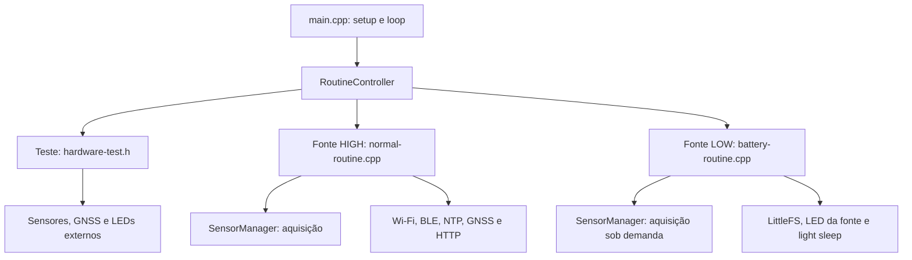

# Índice

- [Visão geral](#visao-geral)
- [Ambiente de desenvolvimento e instalação](#instalacao)
- [Arquitetura e fluxo de execução](#arquitetura)
- [Modos de operação](#modos)
- [Interfaces de hardware e pinagem](#hardware)
- [Parâmetros de configuração](#parametros)
- [Sinalização por LEDs](#leds)
- [Aquisição GNSS e gerenciamento de localização](#gnss)
- [Comunicação e formato dos dados](#comunicacao)
- [Persistência e recuperação de registros](#persistencia)
- [Gerenciamento de energia](#energia)
- [Compilação e testes](#testes)
- [Changelog](#changelog)
- [Referência dos arquivos](#arquivos)

<details>
<summary><strong>Índice de arquivos e responsabilidades</strong></summary>

| Arquivo | Função |
| --- | --- |
| [.github/workflows/firmware.yml](.github/workflows/firmware.yml) | Compilação e testes automáticos |
| [.gitignore](.gitignore) | Arquivos fora do Git |
| [.vscode/extensions.json](.vscode/extensions.json) | Extensões recomendadas |
| [README.md](README.md) | Guia do firmware |
| [include/README](include/README) | Pasta de headers compartilhados |
| [lib/README](lib/README) | Pasta de bibliotecas locais |
| [platformio.ini](platformio.ini) | Placa e dependências |
| [scripts/run-host-tests.sh](scripts/run-host-tests.sh) | Executa os testes sem placa |
| [src/api/api.cpp](src/api/api.cpp) | Arquivo reservado da API |
| [src/api/json-builder.cpp](src/api/json-builder.cpp) | JSON enviado ao backend |
| [src/api/json-builder.h](src/api/json-builder.h) | Interface de serialização |
| [src/bluetooth/ble-callbacks.h](src/bluetooth/ble-callbacks.h) | Callbacks NimBLE |
| [src/bluetooth/ble-manager.cpp](src/bluetooth/ble-manager.cpp) | Provisionamento BLE e fragmentação |
| [src/bluetooth/ble-manager.h](src/bluetooth/ble-manager.h) | Interface do transporte BLE |
| [src/bluetooth/ble-uuid.h](src/bluetooth/ble-uuid.h) | Identificadores do serviço BLE |
| [src/config/config.h](src/config/config.h) | Pinagem e parâmetros gerais |
| [src/config/settings-manager.cpp](src/config/settings-manager.cpp) | Persistência de configurações no NVS |
| [src/config/settings-manager.h](src/config/settings-manager.h) | Interface das configurações persistidas |
| [src/device/device-identity.cpp](src/device/device-identity.cpp) | Identificador derivado do ESP32 |
| [src/device/device-identity.h](src/device/device-identity.h) | Interface do identificador de hardware |
| [src/hardware-test.h](src/hardware-test.h) | Diagnóstico físico dos sensores e LEDs |
| [src/led/status-leds.h](src/led/status-leds.h) | LEDs externos e ajuste de brilho |
| [src/location/location-manager.cpp](src/location/location-manager.cpp) | Busca, persistência e envio de posição |
| [src/location/location-manager.h](src/location/location-manager.h) | Estado da localização da estação |
| [src/location/location-schedule.h](src/location/location-schedule.h) | Agenda monotônica de GNSS |
| [src/main.cpp](src/main.cpp) | Seleciona o modo e delega rotinas |
| [src/network/station-http-client.cpp](src/network/station-http-client.cpp) | Requisições autenticadas da estação |
| [src/network/station-http-client.h](src/network/station-http-client.h) | Interface das requisições HTTP |
| [src/network/wifi-manager.cpp](src/network/wifi-manager.cpp) | Conexão e encerramento do Wi-Fi |
| [src/network/wifi-manager.h](src/network/wifi-manager.h) | Interface de rede Wi-Fi |
| [src/power/power-manager.cpp](src/power/power-manager.cpp) | Controle de energia do ESP32 |
| [src/power/power-manager.h](src/power/power-manager.h) | Interface de alimentação e repouso |
| [src/protocol/protocol-handler.cpp](src/protocol/protocol-handler.cpp) | Comandos de configuração da estação |
| [src/protocol/protocol-handler.h](src/protocol/protocol-handler.h) | Interface dos comandos BLE |
| [src/routines/battery-routine.cpp](src/routines/battery-routine.cpp) | Economia e gravação local |
| [src/routines/battery-routine.h](src/routines/battery-routine.h) | Estados da coleta em bateria |
| [src/routines/normal-routine.cpp](src/routines/normal-routine.cpp) | Aquisição, configuração e envio |
| [src/routines/normal-routine.h](src/routines/normal-routine.h) | Interface da rotina normal |
| [src/routines/routine-controller.cpp](src/routines/routine-controller.cpp) | Despacha teste, normal ou bateria |
| [src/routines/routine-controller.h](src/routines/routine-controller.h) | Interface do controlador |
| [src/sensors/aht20-bmp280.cpp](src/sensors/aht20-bmp280.cpp) | AHT20 sob demanda e BMP280 forçado |
| [src/sensors/aht20-bmp280.h](src/sensors/aht20-bmp280.h) | Interface de temperatura, umidade e pressão |
| [src/sensors/bh1750.cpp](src/sensors/bh1750.cpp) | Leitura de luz com power down |
| [src/sensors/bh1750.h](src/sensors/bh1750.h) | Interface do luxímetro |
| [src/sensors/gnss-manager.cpp](src/sensors/gnss-manager.cpp) | Recepção GNSS opcional |
| [src/sensors/gnss-manager.h](src/sensors/gnss-manager.h) | Dados e interface GNSS |
| [src/sensors/sensor-data.h](src/sensors/sensor-data.h) | Dados ambientais |
| [src/sensors/sensor-manager.cpp](src/sensors/sensor-manager.cpp) | Coordena barramento e sensores |
| [src/sensors/sensor-manager.h](src/sensors/sensor-manager.h) | Interface dos sensores |
| [src/sensors/sps30.cpp](src/sensors/sps30.cpp) | Protocolo de repouso do SPS30 |
| [src/sensors/sps30.h](src/sensors/sps30.h) | Interface de partículas e energia |
| [src/station/station-context.cpp](src/station/station-context.cpp) | Inicialização local e montagem da coleta |
| [src/station/station-context.h](src/station/station-context.h) | Serviços locais compartilhados |
| [src/station/station-data.h](src/station/station-data.h) | Modelo de medição da estação |
| [src/storage/pending-measurement-store.cpp](src/storage/pending-measurement-store.cpp) | Fila JSONL persistente no LittleFS |
| [src/storage/pending-measurement-store.h](src/storage/pending-measurement-store.h) | Interface das filas locais |
| [src/time/time-manager.cpp](src/time/time-manager.cpp) | Sincronização NTP na fonte |
| [src/time/time-manager.h](src/time/time-manager.h) | Interface do relógio |
| [src/time/utc-epoch.h](src/time/utc-epoch.h) | Conversão de data GPS para Unix UTC |
| [test/README](test/README) | Como ler os testes |
| [test/ble-host/Arduino.h](test/ble-host/Arduino.h) | Simulação para testes BLE |
| [test/ble-host/NimBLEDevice.h](test/ble-host/NimBLEDevice.h) | Simulação para testes BLE |
| [test/ble-host/device/device-identity.h](test/ble-host/device/device-identity.h) | Simulação para testes BLE |
| [test/ble_transport_test.cpp](test/ble_transport_test.cpp) | Testes do transporte BLE |
| [test/host/Arduino.h](test/host/Arduino.h) | Simulação para testes de persistência |
| [test/host/Preferences.h](test/host/Preferences.h) | Simulação para testes de persistência |
| [test/host/WiFi.h](test/host/WiFi.h) | Simulação para testes de persistência |
| [test/host/esp_timer.h](test/host/esp_timer.h) | Simulação para testes de persistência |
| [test/host/network/station-http-client.h](test/host/network/station-http-client.h) | Simulação para testes de persistência |
| [test/host/sensors/gnss-manager.h](test/host/sensors/gnss-manager.h) | Simulação para testes de persistência |
| [test/host/time/time-manager.h](test/host/time/time-manager.h) | Simulação para testes de persistência |
| [test/local_queues_test.cpp](test/local_queues_test.cpp) | Testes das filas locais |
| [test/location_manager_test.cpp](test/location_manager_test.cpp) | Testes da localização persistida |
| [test/location_schedule_test.cpp](test/location_schedule_test.cpp) | Testes da agenda GNSS |
| [test/measurement_configuration_test.cpp](test/measurement_configuration_test.cpp) | Testes do intervalo persistido |
| [test/routine_power_test.cpp](test/routine_power_test.cpp) | Testes das rotinas e transições |
| [test/runtime-host/Arduino.h](test/runtime-host/Arduino.h) | Simulação para testes das rotinas |
| [test/runtime-host/bluetooth/ble-manager.h](test/runtime-host/bluetooth/ble-manager.h) | Simulação para testes das rotinas |
| [test/runtime-host/hardware-test.h](test/runtime-host/hardware-test.h) | Simulação para testes das rotinas |
| [test/runtime-host/network/station-http-client.h](test/runtime-host/network/station-http-client.h) | Simulação para testes das rotinas |
| [test/runtime-host/network/wifi-manager.h](test/runtime-host/network/wifi-manager.h) | Simulação para testes das rotinas |
| [test/runtime-host/protocol/protocol-handler.h](test/runtime-host/protocol/protocol-handler.h) | Simulação para testes das rotinas |
| [test/runtime-host/station/station-context.h](test/runtime-host/station/station-context.h) | Simulação para testes das rotinas |
| [test/sensor-host/Arduino.h](test/sensor-host/Arduino.h) | Simulação para testes do SPS30 |
| [test/sensor-host/SensirionI2cSps30.h](test/sensor-host/SensirionI2cSps30.h) | Simulação para testes do SPS30 |
| [test/sensor-host/Wire.h](test/sensor-host/Wire.h) | Simulação para testes do SPS30 |
| [test/sps30_power_test.cpp](test/sps30_power_test.cpp) | Testes do repouso do SPS30 |
| [test/storage-host/Arduino.h](test/storage-host/Arduino.h) | Simulação para testes do LittleFS |
| [test/storage-host/LittleFS.h](test/storage-host/LittleFS.h) | Simulação para testes do LittleFS |

</details>

<a id="visao-geral"></a>
# Firmware CASA

Firmware de aquisição ambiental para ESP32-S3, responsável pela leitura de sensores, provisionamento Bluetooth Low Energy, comunicação com a API CASA e persistência local de medições. A seleção entre diagnóstico de hardware, operação normal e operação em bateria é realizada pelo controlador de rotinas.

| Propriedade | Definição |
| --- | --- |
| Plataforma de execução | ESP32-S3 |
| Ambiente PlatformIO | `esp32-s3-devkitm-1` |
| Framework | Arduino |
| Versão do firmware | `1.4.0-dev` |
| Sensores ambientais | AHT20, BMP280, BH1750 e SPS30 |
| Receptor de posicionamento | GNSS por UART; integração com NEO-6M e TinyGPSPlus |
| Persistência | NVS para configuração/localização; LittleFS para registros JSONL |
| Comunicação externa | BLE para provisionamento; Wi-Fi e HTTP para integração com a API |

<a id="instalacao"></a>
## Ambiente de desenvolvimento e instalação

### Dependências

A configuração de compilação é declarada em [platformio.ini](platformio.ini).

| Dependência | Versão declarada | Responsabilidade |
| --- | --- | --- |
| Plataforma Espressif32 | `6.12.0` | Toolchain e suporte ao ESP32-S3 |
| NimBLE-Arduino | `2.5.0` | Serviço e transporte BLE |
| ArduinoJson | `7.4.3` | Serialização e interpretação JSON |
| Adafruit AHTX0 | Sem versão fixada | Aquisição AHT20 |
| Adafruit BMP280 Library | Sem versão fixada | Aquisição BMP280 |
| Sensirion Core | Tag `0.7.3` | Camada de comunicação Sensirion |
| Sensirion I2C SPS30 | Tag `1.0.1` | Protocolo do SPS30 |
| BH1750 | `1.3.0` | Aquisição de iluminância |
| TinyGPSPlus | `1.1.0` | Decodificação das mensagens GNSS |

### Instalação no VS Code

1. Instalar o [Visual Studio Code](https://code.visualstudio.com/) e a extensão **PlatformIO IDE**, publicada pela PlatformIO.
2. Clonar o repositório ou extrair o arquivo de distribuição do código.
3. Abrir, no VS Code, o diretório que contém `platformio.ini`. A extensão utiliza esse arquivo para identificar o ambiente e resolver as dependências.
4. Executar **PlatformIO: Build**, **PlatformIO: Upload** e **PlatformIO: Serial Monitor** para compilação, gravação e diagnóstico.

O PlatformIO Core é incluído na extensão. A instalação e o uso da interface estão descritos na [documentação oficial do PlatformIO](https://docs.platformio.org/en/latest/integration/ide/vscode.html).

```bash
git clone --branch development https://github.com/lucas-velocini-repo/ESP32-IT-Estacao_Meteorologica.git
cd ESP32-IT-Estacao_Meteorologica
pio pkg install
pio run -e esp32-s3-devkitm-1
```

### Gravação e monitoramento

```bash
pio run -e esp32-s3-devkitm-1 --target upload --upload-port COM13
pio device monitor --port COM13 --baud 19200
```

`COM13` representa uma porta de exemplo. A opção `--upload-port` pode ser omitida para detecção automática. Em Linux, as portas normalmente são expostas como `/dev/ttyUSB0` ou `/dev/ttyACM0`.

A gravação de firmware utiliza a partição de programa. Operações de apagamento completo da flash ou gravação de imagem do filesystem podem remover configurações NVS e registros LittleFS.

### Provisionamento

O provisionamento ocorre no modo normal, com `TEST_MODE=false` e `POWER_SOURCE=HIGH`. O cliente BLE configura identificação da estação, token de API, nome, rede e URL de ingestão. Os valores são persistidos no NVS.

A URL configurada deve terminar em `/measurements` para a derivação das rotas de localização e configuração. O formato dos comandos e das requisições está descrito em [Comunicação e formato dos dados](#comunicacao).

<a id="arquitetura"></a>
## Arquitetura e fluxo de execução

[main.cpp](src/main.cpp) contém os pontos de entrada Arduino `setup()` e `loop()` e a constante `TEST_MODE`. A execução é delegada ao `RoutineController`.

O controlador mantém um `StationContext` com configurações, sensores, relógio, localização e armazenamento. A infraestrutura de Wi-Fi, BLE, protocolo e HTTP pertence à rotina normal.



As transições normal/bateria são confirmadas após `POWER_DEBOUNCE_MS` de estabilidade. O NVS e os serviços locais permanecem inicializados durante a troca de rotina. Tarefas da rotina anterior deixam de ser chamadas enquanto o controlador confirma uma mudança de alimentação.

<a id="modos"></a>
## Modos de operação

| TEST_MODE | POWER_SOURCE | Modo |
| --- | --- | --- |
| `true` | Qualquer nível | Teste de hardware |
| `false` | `HIGH` | Operação normal |
| `false` | `LOW` | Operação em bateria |

### Teste de hardware

Implementado por `HardwareTest::begin()` e `HardwareTest::update()` em [hardware-test.h](src/hardware-test.h).

- Inicializa o barramento I2C, os sensores e a UART GNSS.
- Processa a recepção GNSS a cada passagem pelo controlador.
- Executa leituras ambientais e apresenta o estado do GNSS a cada 2000 ms.
- Alterna os três LEDs externos entre vermelho, azul e ambos, com 1000 ms por estado.
- Opera sem inicializar Wi-Fi/BLE e sem persistência ou envio de medições.

O modo de teste tem prioridade sobre a entrada de alimentação: a transição de `POWER_SOURCE` para LOW não seleciona a rotina de bateria enquanto `TEST_MODE=true`.

### Operação normal

Implementada em [normal-routine.cpp](src/routines/normal-routine.cpp).

1. Habilita os recursos de operação normal e inicia recepção GNSS, BLE e conexão Wi-Fi.
2. Solicita sincronização NTP e acompanha o relógio no ciclo de execução.
3. Processa comandos de configuração e atualizações de localização.
4. Consulta a configuração remota e confirma o intervalo efetivamente persistido.
5. Reenvia registros pendentes quando a conexão está disponível.
6. Realiza aquisição e tentativa de envio de acordo com o intervalo configurado.

A aquisição normal exige identificação da estação, token configurado e horário UTC válido. Ausência de localização GNSS não bloqueia a aquisição ambiental; as coordenadas são serializadas como `null` quando indisponíveis.

### Operação em bateria

Implementada em [battery-routine.cpp](src/routines/battery-routine.cpp). Não inicializa nem consulta interfaces Wi-Fi, BLE, NTP ou UART GNSS. As coletas são encaminhadas ao armazenamento local.

| Fase | Operação |
| --- | --- |
| Repouso | Aguarda o prazo de aquisição e mantém os sensores em seus estados de baixo consumo |
| Estabilização | Acorda/inicia o SPS30 e aguarda `SPS30_WARMUP_MS` |
| Conversão de luz | Solicita uma medição única do BH1750 e aguarda `LIGHT_CONVERSION_MS` |
| Aquisição | Solicita amostra do SPS30 e lê os demais sensores; repete a tentativa de PM até o timeout |
| Persistência | Suspende as medições, grava o registro e agenda o próximo ciclo |

No timeout de partículas, os demais sensores são capturados e os campos de PM indisponíveis permanecem `null`. Uma falha ao iniciar o SPS30 suprime a espera de estabilização, mantendo o tratamento de timeout e a aquisição das outras grandezas.

O primeiro ciclo é iniciado na entrada do modo de bateria. O prazo do ciclo seguinte é calculado por:

```text
t_proximo = max(t_inicio + intervalo_configurado, t_fim + MIN_SLEEP_MS)
```

Assim, intervalos menores que o tempo de aquisição e repouso resultam em um período efetivo maior que o valor configurado. O retorno da fonte encerra a rotina de bateria e cancela uma aquisição ainda incompleta.

<a id="hardware"></a>
## Interfaces de hardware e pinagem

A pinagem é declarada no namespace `Pins` de [config.h](src/config/config.h). O barramento I2C opera a 100 kHz. As interfaces digitais do ESP32-S3 utilizam nível lógico de 3,3 V.

| Interface | Sinal | GPIO |
| --- | --- | --- |
| I2C | SDA | 8 |
| I2C | SCL | 9 |
| UART GNSS | RX do ESP32, conectado ao TX do receptor | 18 |
| UART GNSS | TX do ESP32, conectado ao RX do receptor | 17 |
| Alimentação | `POWER_SOURCE` | 7 |
| LED RGB endereçável | Dados | 48 |
| Alimentação GNSS | `GNSS_POWER_ENABLE` | `-1`: saída não configurada |

`POWER_SOURCE` é uma entrada fornecida pelo circuito de alimentação: HIGH indica fonte externa e LOW indica bateria. A entrada requer referência de GND comum e nível definido.

Os LEDs externos são bicolores de cátodo comum, com resistor limitador em cada anodo.

| Identificador lógico | Função | RED | BLUE |
| --- | --- | --- | --- |
| LED1 | Bluetooth | GPIO14 | GPIO13 |
| LED2 | Wi-Fi | GPIO12 | GPIO11 |
| LED3 | Alimentação | GPIO5 | GPIO4 |

| Sensor | Grandezas | Interface/endereço |
| --- | --- | --- |
| AHT20 | Temperatura e umidade relativa | I2C `0x38` |
| BMP280 | Pressão atmosférica | I2C `0x77` ou `0x76` |
| BH1750 | Iluminância | I2C `0x23` |
| SPS30 | Material particulado e concentração numérica | I2C `0x69` |
| GNSS | Posição, altitude, satélites, HDOP e UTC | `Serial1`, 9600 bit/s, 8N1 |

<a id="parametros"></a>
## Parâmetros de configuração

| Parâmetro | Valor padrão | Definição |
| --- | --- | --- |
| `TEST_MODE` | `false` | Seleção de diagnóstico em `main.cpp` |
| `DATA_SEND_INTERVAL_MS` | 300000 ms | Intervalo inicial de aquisição |
| Intervalo persistido de aquisição | 30 a 86400 s | Configuração em `SettingsManager` |
| `CONFIG_POLL_INTERVAL_MS` | 60000 ms | Período de consulta da configuração remota |
| `GNSS_BAUD_RATE` | 9600 bit/s | Velocidade da UART GNSS |
| `GNSS_MAX_FIX_AGE_MS` | 300000 ms | Idade máxima aceita pelo `GNSSManager` |
| `BatteryConfig::SPS30_WARMUP_MS` | 30000 ms | Estabilização do SPS30 |
| `BatteryConfig::SPS30_READ_TIMEOUT_MS` | 5000 ms | Janela de tentativa de leitura de partículas |
| `BatteryConfig::LIGHT_CONVERSION_MS` | 180 ms | Conversão única do BH1750 |
| `BatteryConfig::MIN_SLEEP_MS` | 30000 ms | Repouso mínimo após a coleta em bateria |
| `BatteryConfig::LED_PERIOD_MS` | 5000 ms | Período do indicador de bateria |
| `BatteryConfig::LED_ON_MS` | 1000 ms | Tempo ligado do indicador de bateria |
| `BatteryConfig::POWER_DEBOUNCE_MS` | 50 ms | Confirmação da transição de alimentação |

Os parâmetros de hardware e temporização são definidos em compilação. Identidade, credenciais, servidor, nome e intervalo/revisão são configurados em execução e persistidos no NVS.

<a id="leds"></a>
## Sinalização por LEDs

[StatusLeds](src/led/status-leds.h) centraliza o acionamento dos LEDs externos. `StatusLeds::write()` aplica PWM de 8 bits por `analogWrite()`.

```cpp
constexpr uint8_t RED_BRIGHTNESS = 48;
constexpr uint8_t BLUE_BRIGHTNESS = 20;
```

Cada constante define o duty cycle dos canais da respectiva cor, no intervalo de 0 a 255. O valor 0 desliga o canal e 255 representa duty cycle máximo. A configuração é compartilhada pelos modos normal, bateria e teste. O cache de duty cycle evita reconfigurar o LEDC quando o valor solicitado permanece igual.

| Modo | LED1: Bluetooth | LED2: Wi-Fi | LED3: alimentação |
| --- | --- | --- | --- |
| Normal | Azul durante conexão BLE | Azul durante conexão Wi-Fi | Azul contínuo |
| Bateria | Desligado | Desligado | Vermelho por 1 s em cada período de 5 s |
| Teste | Vermelho, azul e ambos em sequência | Vermelho, azul e ambos em sequência | Vermelho, azul e ambos em sequência |

O RGB interno recebe um quadro preto na inicialização. Indicadores ligados diretamente à alimentação não são endereçáveis pelo firmware; seu estado depende do circuito elétrico. O controle por software inicia durante `setup()` e não abrange a etapa de boot/reset anterior à aplicação.

<a id="gnss"></a>
## Aquisição GNSS e gerenciamento de localização

### Recepção

[GNSSManager](src/sensors/gnss-manager.cpp) decodifica mensagens NMEA com TinyGPSPlus. A cada posição válida atualizada, mantém coordenadas, instante monotônico do fix e número sequencial. Altitude, satélites e HDOP são atualizados quando os respectivos campos estão disponíveis. A data/hora GNSS recente é convertida para epoch UTC.

`getData()` retorna os dados armazenados e `hasFix()` verifica a idade da última posição. Com o valor padrão de `GNSS_MAX_FIX_AGE_MS`, um fix permanece válido por até 300 s sem atualização. O modo de teste apresenta também `lastFixAgeMs`, distinguindo uma posição armazenada de uma atualização recente.

O diagnóstico periódico, a cada 60 s, informa a ausência de mensagens NMEA válidas recebidas ou a falta de posição válida.

### Localização da estação

[LocationManager](src/location/location-manager.cpp) aplica uma agenda de localização independente da frequência de aquisição ambiental.

| Evento | Comportamento |
| --- | --- |
| Inicialização | Abre uma busca, mesmo quando há localização persistida |
| Busca bem-sucedida | Agenda a próxima obtenção para 24 h após o sucesso |
| Busca sem sucesso | Timeout de 5 min e nova tentativa após 15 min |
| Seleção de fix | Posição recebida após o início da busca, com idade máxima de 5 s |
| Persistência | Coordenadas, identidade, horário de obtenção e pendência salvos no NVS |
| Envio | `PATCH` de localização com retentativa em caso de falha |

O horário de obtenção utiliza UTC do GNSS ou, quando disponível, o relógio sincronizado descontando a idade do fix. Posições de outra identidade não são reutilizadas. No modo de bateria, a posição persistida da identidade configurada é consultada sem recepção GNSS.

### TIMEPULSE e alimentação do receptor

A inicialização transmite `UBX-CFG-TP5` com o bit Active desativado e programa três repetições com espaçamento mínimo de 1 s. O comando solicita a desativação de TIMEPULSE; o firmware não verifica ACK desse comando. O efeito sobre um LED de fix depende de sua ligação ao sinal e do suporte do receptor.

`Pins::GNSS_POWER_ENABLE=-1` indica ausência de saída configurada para controle de alimentação. Com um GPIO configurado e circuito EN/load switch instalado, `PowerManager::gnssPower()` controla a alimentação segundo `GNSS_ENABLE_ACTIVE_HIGH`. Ao desativar o GNSS, os pinos UART são configurados como entradas. Sem comutação elétrica, encerrar a UART não interrompe a alimentação do receptor.

<a id="comunicacao"></a>
## Comunicação e formato dos dados

### Provisionamento BLE

O dispositivo anuncia `CASA-` seguido dos seis últimos caracteres do identificador de hardware. O serviço UART BLE utiliza característica RX para escrita e TX para notificações.

As mensagens são JSON UTF-8. O transporte aceita frames delimitados por quebra de linha e mensagens JSON completas sem delimitador. Respostas são enfileiradas e fragmentadas conforme o MTU após a inscrição do cliente nas notificações. A desconexão descarta respostas da sessão encerrada.

| Comando | Campos de entrada | Resultado |
| --- | --- | --- |
| `get_status` | `command` | Estado de conexão, identidade, servidor, nome e intervalo |
| `configure_wifi` | `ssid`, `password`, `server` | Persiste e aplica configuração de rede pela rotina normal |
| `configure_interval` | `intervalSeconds` | Valida 30 a 86400 s, persiste e retorna confirmação |
| `save_identity` | `deviceId`, `apiToken`; `stationName` opcional | Persiste identidade, credencial e nome |
| `save_server` | `server` | Persiste URL de ingestão |

`configure_interval` requer identidade e token configurados. As respostas de configuração só confirmam o intervalo após a persistência do estado.

A autenticação HTTP utiliza a credencial da estação. O protocolo BLE de configuração não implementa autenticação de contas de usuário do aplicativo.

### Integração HTTP

O cliente inclui `Content-Type: application/json` e `Authorization: Bearer <token>`. Uma resposta HTTP 2xx é tratada como sucesso. Falha de transporte ou resposta fora dessa faixa mantém a necessidade de envio.

Para uma URL de ingestão terminada em `/api/measurements`, os endpoints derivados são:

| Operação | Método | Caminho |
| --- | --- | --- |
| Envio de medição | POST | `/api/measurements` |
| Atualização de localização | PATCH | `/api/devices/location` |
| Consulta de configuração | GET | `/api/devices/config` |
| Confirmação de configuração | POST | `/api/devices/config/report` |

Os timeouts configurados de conexão e leitura são de 3000 ms. A rotina normal consulta o intervalo remoto a cada 60 s. O estado confirmado contém revisão, intervalo, versão do firmware e origem da configuração.

Intervalo e revisão são persistidos conjuntamente. Enquanto houver sobrescrita BLE pendente, revisões remotas anteriores ou iguais à revisão local não substituem o intervalo. Uma revisão remota posterior pode substituí-lo. O relatório de configuração confirmado pelo servidor encerra a marcação de sobrescrita quando intervalo e revisão ainda correspondem ao estado relatado.

### Payload de medição

A serialização é implementada em [json-builder.cpp](src/api/json-builder.cpp).

| Campo | Conteúdo/unidade |
| --- | --- |
| `device_id` | Identificador da estação |
| `timestamp` | Epoch UTC em segundos |
| `latitude`, `longitude` | Graus decimais; `null` sem posição válida |
| `pm` | Concentração mássica em µg/m³; chaves `1.0`, `2.5`, `4.0` e `10.0` |
| `nc` | Concentração numérica em #/cm³; chaves `0.5`, `1.0`, `2.5`, `4.0` e `10.0` |
| `typical_size` | Tamanho típico em µm |
| `temperature` | Temperatura em °C |
| `humidity` | Umidade relativa em % |
| `pressure` | Pressão em hPa |
| `light` | Iluminância em lx |

Valores numéricos indisponíveis representados por NaN são serializados como `null`. A integração com o backend deve contemplar esses campos opcionais para o tratamento de aquisição parcial.

<a id="persistencia"></a>
## Persistência e recuperação de registros

### Configuração e localização

O NVS armazena identidade, token, rede, URL, nome, intervalo/revisão e localização da estação. O estado da configuração do intervalo inclui a origem BLE para aplicação das regras de precedência. A localização inclui seu horário de obtenção e estado de confirmação pelo servidor.

### Filas LittleFS

[PendingMeasurementStore](src/storage/pending-measurement-store.cpp) implementa armazenamento JSONL, com um registro por linha e arquivos temporários independentes.

| Arquivo | Finalidade | Política de envio |
| --- | --- | --- |
| `/pending.jsonl` | Medições datadas e identificadas pendentes de envio | Reenvio pela rotina normal |
| `/pending.tmp` | Compactação/recuperação da fila de envio | Não é enviado |
| `/undated.jsonl` | Coletas de bateria sem UTC válido ou sem identidade | Exclusivamente local; sem promoção automática para envio |
| `/undated.tmp` | Compactação/recuperação dos registros exclusivamente locais | Não é enviado |

Em bateria, registros com UTC e identidade são gravados em `pending`. Os demais recebem `timestamp: null`, `boot_id`, `uptime_ms` e `reason` igual a `identity_missing` ou `clock_unavailable`. O estabelecimento posterior de UTC não altera automaticamente esses registros.

A rotina normal tenta reenviar o primeiro registro de `pending` em intervalos de pelo menos 2000 ms, enquanto houver conexão. Um envio bem-sucedido remove esse registro; falhas mantêm a pendência. Os timestamps armazenados são preservados.

A política de capacidade limita as gravações a 70% do volume LittleFS, considerando o uso compartilhado. A inclusão de um registro pode remover registros mais antigos da própria fila. Falhas de liberação de espaço, abertura, escrita ou cópia são propagadas por retorno de erro e log.

Na recuperação, a presença da fila principal prevalece sobre seu temporário. Se a principal estiver ausente, o temporário é renomeado para recuperá-la. A montagem utiliza `LittleFS.begin(true)`: uma falha de montagem habilita tentativa de formatação do volume.

### Horário

`TimeManager` solicita NTP no modo normal e consulta o relógio local nas leituras de horário. O encerramento do SNTP preserva o RTC para a continuidade em light sleep. O boot sem sincronização não garante UTC válido; essas coletas permanecem na fila exclusivamente local.

<a id="energia"></a>
## Gerenciamento de energia

| Componente | Operação normal | Operação em bateria |
| --- | --- | --- |
| CPU | Frequência registrada na inicialização | 80 MHz |
| Wi-Fi | Conexão e reconexão | Desligado |
| BLE | Provisionamento e notificações | Pilha encerrada |
| GNSS | UART ativa | UART encerrada; alimentação condicionada ao hardware EN |
| AHT20 | Conversão por solicitação de leitura | Conversão por solicitação de leitura e standby do sensor |
| BMP280 | Modo normal | Modo forçado durante a leitura e sleep entre coletas |
| BH1750 | Medição contínua | Conversão única e power down |
| SPS30 | Medição contínua | Estabilização, leitura, stop e sleep |
| SNTP | Sincronização e acompanhamento | Cliente encerrado; consulta ao RTC local |
| LEDs externos | Sinalização de conexão e fonte | Indicador vermelho da fonte |

O SPS30 mantém a alimentação de 5 V durante a operação. O driver executa a sequência wake/start antes da aquisição e stop/sleep após a coleta. Se `sleep` não for aceito e a parada tiver sido confirmada, o sensor permanece em Idle. Falhas ao parar ou iniciar a medição são registradas.

A estabilização padrão do SPS30 é de 30 s e a coleta utiliza uma amostra após essa janela, sem média temporal adicional. Os modos de operação e os tempos de estabilização são descritos na [documentação de baixo consumo da Sensirion](https://sensirion.com/en/media/documents/188A2C3C/6166F165/Sensirion_Particulate_Matter_AppNotes_SPS30_Low_Power_Operation_D1.pdf).

O ESP32 entra em light sleep nos intervalos disponíveis entre tarefas quando o LED da fonte está apagado. O despertar é configurado por timer e por HIGH em GPIO7 via EXT0. Após o despertar, GPIO7 retorna do mux RTC ao uso digital.

Durante o pulso vermelho, a CPU permanece ativa a 80 MHz para sustentar o PWM do LEDC. A duração do repouso é limitada pelo próximo evento de LED ou aquisição. Light sleep preserva RAM e relógio, sem reinicializar a aplicação.

Na transição para bateria, a rotina normal encerra BLE, reconexão Wi-Fi, SNTP e UART. Uma operação HTTP iniciada antes da alteração de alimentação pode concluir ou expirar antes do encerramento. O tempo de debounce não representa uma garantia de latência máxima da transição.

O desligamento elétrico de módulos e indicadores ligados ao VCC depende de EN/load switch ou do circuito de alimentação. A autonomia é uma propriedade do conjunto de hardware, temporização, periféricos e bateria; o firmware não calcula estimativa de carga restante.

<a id="testes"></a>
## Compilação e testes

### Compilação do firmware

```bash
pio run -e esp32-s3-devkitm-1
```

### Testes de host

Requerem Bash, compilador g++ e dependências instaladas pelo PlatformIO.

```bash
pio pkg install
bash scripts/run-host-tests.sh
```

| Teste | Escopo |
| --- | --- |
| `routine_power_test.cpp` | Seleção de modo, debounce, transições, agendamento de bateria, timeout e PWM |
| `local_queues_test.cpp` | Filas independentes, temporários, capacidade compartilhada e falhas de escrita |
| `sps30_power_test.cpp` | Sequência de comandos, repouso, retomada e falhas de leitura |
| `location_schedule_test.cpp` | Agenda, timeout, retentativa, UTC e uptime prolongado |
| `location_manager_test.cpp` | Persistência de posição, identidade, horário e retentativa de envio |
| `measurement_configuration_test.cpp` | Limites, revisões, persistência e precedência BLE/remota |
| `ble_transport_test.cpp` | Fragmentação, MTU, inscrição, falhas de notificação e encerramento/reabertura |

O runner compila os testes com C++11, `-Wall`, `-Wextra` e `-Werror`. Os adaptadores de host substituem interfaces de hardware e não integram o firmware.

O workflow [firmware.yml](.github/workflows/firmware.yml) executa a compilação e os testes em pull requests e nos pushes das branches configuradas. A validação física abrange integridade elétrica, resposta dos sensores, recepção GNSS, consumo e retenção de dados; essas propriedades não são verificadas pelos adaptadores de host.

<a id="changelog"></a>
## Changelog

| Versão | Comportamento documentado |
| --- | --- |
| `1.4.0-dev` | Controle de rotinas por modo de teste e alimentação; aquisição local em bateria, gerenciamento de repouso dos sensores, PWM dos LEDs e pinagem de Bluetooth/Wi-Fi/fonte |
| `1.3.1` | Transporte BLE com fila de respostas, fragmentos imutáveis e controle de notificações por conexão |
| `1.3.0` | Configuração persistida do intervalo por BLE e enquadramento JSON por linhas |
| `1.2.0` | Consulta remota do intervalo de aquisição e confirmação de revisão persistida |


<a id="arquivos"></a>
## Referência dos arquivos

Os headers `.h` definem interfaces e estruturas; os arquivos `.cpp` contêm as implementações. Os diretórios `test/host`, `test/ble-host`, `test/runtime-host`, `test/sensor-host` e `test/storage-host` fornecem adaptadores exclusivos dos testes de host.

### Raiz, configuração e automação

| Arquivo | Funcionamento |
| --- | --- |
| [.github/workflows/firmware.yml](.github/workflows/firmware.yml) | Executa a compilação PlatformIO e os testes C++ de host em pull requests e nos pushes das branches configuradas. |
| [.gitignore](.gitignore) | Exclui saídas do PlatformIO e arquivos locais de editor do versionamento. |
| [.vscode/extensions.json](.vscode/extensions.json) | Declara as extensões recomendadas para desenvolvimento no VS Code. |
| [README.md](README.md) | Ponto de entrada da documentação: instalação, seleção de rotinas, alimentação, changelog e referências de todos os arquivos. |
| [include/README](include/README) | Documenta a pasta de inclusão global do PlatformIO. As interfaces do firmware são organizadas nos subdiretórios de src. |
| [lib/README](lib/README) | Documenta a estrutura de bibliotecas privadas do PlatformIO. As dependências externas são declaradas em platformio.ini. |
| [platformio.ini](platformio.ini) | Define o ambiente esp32-s3-devkitm-1, plataforma espressif32 6.12.0, framework Arduino, dependências e monitor serial a 19200 bit/s. A seleção da porta de upload é automática. |
| [scripts/run-host-tests.sh](scripts/run-host-tests.sh) | Compila e executa sete testes C++ de rotinas, filas, SPS30, agenda GNSS, localização, configuração e BLE. Os binários são gerados em diretório temporário e removidos após a execução. |

### Controle de rotinas, estação e energia

| Arquivo | Funcionamento |
| --- | --- |
| [src/hardware-test.h](src/hardware-test.h) | Lê sensores a cada 2 s, recebe GNSS continuamente e alterna os LEDs externos entre vermelho, azul e ambos, 1 s por estado. Reutiliza o PWM de StatusLeds e não inicia Wi-Fi/BLE. |
| [src/led/status-leds.h](src/led/status-leds.h) | StatusLeds::write concentra analogWrite e os valores independentes RED_BRIGHTNESS/BLUE_BRIGHTNESS. normal mostra conexões/fonte; battery apaga todos os outros canais e gera 1 s vermelho a cada 5 s. |
| [src/main.cpp](src/main.cpp) | Contém TEST_MODE e apenas chama begin/update do RoutineController em setup/loop. Não lê sensores, não configura redes e não monta payloads. |
| [src/power/power-manager.cpp](src/power/power-manager.cpp) | Apaga o RGB, deixa a UART GNSS em alta impedância quando desativada, aplica 80 MHz na bateria e restaura a frequência ao voltar a fonte. Usa timer e GPIO7 para acordar do light sleep. A polaridade do EN opcional está neste arquivo. |
| [src/power/power-manager.h](src/power/power-manager.h) | Expõe leitura da fonte, controle opcional da alimentação GNSS, LED RGB, frequência de CPU e light sleep. |
| [src/routines/battery-routine.cpp](src/routines/battery-routine.cpp) | Acorda o SPS30, aguarda a estabilização, prepara a conversão de luz e salva a coleta no LittleFS. Não chama Wi-Fi, BLE, NTP ou leitura GNSS. Intercala tarefas com light sleep e atualiza somente o LED vermelho da fonte. |
| [src/routines/battery-routine.h](src/routines/battery-routine.h) | Declara a máquina de estados: repouso, estabilização do SPS30 e leitura. Usa prazos monotônicos de 64 bits. |
| [src/routines/normal-routine.cpp](src/routines/normal-routine.cpp) | Executa recepção GNSS, transporte BLE, rede Wi-Fi, sincronização NTP, localização, configuração remota, aquisição e reenvio. end encerra BLE, Wi-Fi, SNTP e UART para a transição ao modo de bateria. |
| [src/routines/normal-routine.h](src/routines/normal-routine.h) | Agrupa WiFiManager, BLEManager, ProtocolHandler e StationHttpClient e os tempos de aquisição, reenvio e consulta de configuração. |
| [src/routines/routine-controller.cpp](src/routines/routine-controller.cpp) | Inicializa a infraestrutura local e seleciona o modo de execução. TEST_MODE tem prioridade; fora do teste, o nível de POWER_SOURCE determina a rotina após debounce de 50 ms. |
| [src/routines/routine-controller.h](src/routines/routine-controller.h) | Declara os três modos, os recursos locais e as duas rotinas; mantém o estado da fonte e o tempo de debounce. |
| [src/station/station-context.cpp](src/station/station-context.cpp) | Inicializa os serviços locais, constrói StationData e encaminha a persistência. Utiliza o RTC e a localização associada à identidade configurada; registros sem UTC ou identificação recebem metadados de boot e uptime. |
| [src/station/station-context.h](src/station/station-context.h) | Reúne configurações NVS, sensores, relógio, posição armazenada e as filas pending/undated. Nenhum rádio é inicializado por este contexto. |
| [src/station/station-data.h](src/station/station-data.h) | Agrupa identidade, nome, horário, posição válida/opcional e SensorData antes de gerar o JSON. |

### Configuração e identidade

| Arquivo | Funcionamento |
| --- | --- |
| [src/config/config.h](src/config/config.h) | Centraliza versão, I2C, UART GNSS, POWER_SOURCE, LEDs e EN opcional do GPS. BatteryConfig reúne estabilização, timeout, repouso mínimo, conversão de luz, debounce e duração do pisca. |
| [src/config/settings-manager.cpp](src/config/settings-manager.cpp) | Persiste configurações no NVS. Intervalo, revisão e origem BLE são gravados como um estado conjunto, com mutex e regras de precedência entre configuração local e revisão remota. |
| [src/config/settings-manager.h](src/config/settings-manager.h) | Declara acesso a identidade, token, rede, servidor, nome e intervalo/revisão. A declaração legada HttpClient ao final não participa da rotina atual. |
| [src/device/device-identity.cpp](src/device/device-identity.cpp) | Obtém o ID a partir do hardware do ESP32; independe da identidade de cadastro fornecida pelo backend. |
| [src/device/device-identity.h](src/device/device-identity.h) | Declara o identificador estável usado para distinguir estações. |

### Sensores

| Arquivo | Funcionamento |
| --- | --- |
| [src/sensors/aht20-bmp280.cpp](src/sensors/aht20-bmp280.cpp) | Detecta o BMP280 em 0x77 ou 0x76 e converte Pa para hPa. Na bateria dispara a conversão de pressão ao coletar e retorna ao sleep; o AHT20 usa conversões sob demanda e standby próprio. |
| [src/sensors/aht20-bmp280.h](src/sensors/aht20-bmp280.h) | Mantém os drivers Adafruit, os estados de detecção e a configuração de economia do BMP280. |
| [src/sensors/bh1750.cpp](src/sensors/bh1750.cpp) | Usa I2C 0x23. Na fonte mantém a leitura contínua; na bateria inicia ONE_TIME_HIGH_RES_MODE, espera a conversão pelo agendamento e aproveita o desligamento automático. suspend envia POWER DOWN. |
| [src/sensors/bh1750.h](src/sensors/bh1750.h) | Declara leitura contínua, conversão única e power down do BH1750. |
| [src/sensors/gnss-manager.cpp](src/sensors/gnss-manager.cpp) | Decodifica NMEA com TinyGPSPlus e obtém data UTC do GPS. No begin envia UBX-CFG-TP5 com timepulse desabilitado; end encerra a UART. Não é inicializado na partida em bateria e não é atualizado nessa rotina. |
| [src/sensors/gnss-manager.h](src/sensors/gnss-manager.h) | Declara posição, idade do fix, satélites, HDOP, sequência e data UTC. Oferece begin/update/end da UART. |
| [src/sensors/sensor-data.h](src/sensors/sensor-data.h) | Define os campos ambientais de temperatura, umidade, pressão, iluminância, PM, concentração numérica e tamanho típico. Campos indisponíveis são inicializados com NaN e serializados como null. |
| [src/sensors/sensor-manager.cpp](src/sensors/sensor-manager.cpp) | Inicializa o I2C a 100 kHz e coordena os drivers. No modo de bateria prepara o SPS30 e a conversão de luz, solicita leitura de partículas e captura os demais sensores ao obter dados ou atingir o timeout. |
| [src/sensors/sensor-manager.h](src/sensors/sensor-manager.h) | Oferece leitura normal e preparação, captura e suspensão de uma coleta em bateria. A mesma camada de sensores é compartilhada pelas rotinas. |
| [src/sensors/sps30.cpp](src/sensors/sps30.cpp) | Usa wakeUpSequence, startMeasurement, stopMeasurement e sleep, sem desligar os 5 V. Verifica data-ready e propaga falhas. Se o firmware não aceitar sleep, deixa o sensor em Idle, com ventilador e laser parados quando stop foi confirmado. |
| [src/sensors/sps30.h](src/sensors/sps30.h) | Controla estados de medição e sleep e expõe leitura com indicação de sucesso. Não apresenta uma amostra anterior como se fosse nova. |

### Localização e horário

| Arquivo | Funcionamento |
| --- | --- |
| [src/location/location-manager.cpp](src/location/location-manager.cpp) | Aceita fix novo e recente na inicialização e a cada 24 h; busca por até 5 min e repete após 15 min se falhar. Salva posição e pendência no NVS antes de enviá-las. É atualizado somente na rotina normal. |
| [src/location/location-manager.h](src/location/location-manager.h) | Declara localização persistida, agenda e estado de envio. belongsTo permite reutilizar uma posição apenas para a identidade que a obteve. |
| [src/location/location-schedule.h](src/location/location-schedule.h) | Implementa busca inicial, timeout, retentativa e período diário, sem depender de ajustes de NTP ou de millis de 32 bits. |
| [src/time/time-manager.cpp](src/time/time-manager.cpp) | Inicializa e acompanha a sincronização NTP no modo normal. end interrompe SNTP e preserva o relógio do sistema. now e isSynchronized consultam o estado local sem iniciar acesso à rede. |
| [src/time/time-manager.h](src/time/time-manager.h) | Separa início/parada do SNTP de consultas ao RTC e verificação de UTC válido. |
| [src/time/utc-epoch.h](src/time/utc-epoch.h) | Converte campos de calendário em epoch sem depender do fuso horário local do ambiente. |

### Rede, BLE, protocolo e API

| Arquivo | Funcionamento |
| --- | --- |
| [src/api/api.cpp](src/api/api.cpp) | Contém apenas o include de config. A serialização e o transporte efetivos ficam em json-builder e station-http-client. |
| [src/api/json-builder.cpp](src/api/json-builder.cpp) | Monta device_id, timestamp, posição opcional, PM, concentrações numéricas, tamanho típico, luz, temperatura, umidade e pressão. |
| [src/api/json-builder.h](src/api/json-builder.h) | Declara a criação do payload JSON a partir de StationData. |
| [src/bluetooth/ble-callbacks.h](src/bluetooth/ble-callbacks.h) | Encaminha conexão, desconexão, escrita e inscrição de notificações ao BLEManager; não contém a rotina principal da estação. |
| [src/bluetooth/ble-manager.cpp](src/bluetooth/ble-manager.cpp) | Gerencia anúncio CASA-<sufixo do hardware ID>, recepção JSON e notificações fragmentadas por conexão. O envio depende de inscrição do cliente; end encerra a pilha, limpa a sessão e libera os objetos NimBLE. |
| [src/bluetooth/ble-manager.h](src/bluetooth/ble-manager.h) | Declara callbacks, estado de conexão, fila de respostas, mutex e controle de início/encerramento. |
| [src/bluetooth/ble-uuid.h](src/bluetooth/ble-uuid.h) | Centraliza os UUIDs do serviço UART e das características RX/TX usadas pelo aplicativo. |
| [src/network/station-http-client.cpp](src/network/station-http-client.cpp) | Executa requisições HTTP com Bearer token. Verifica fonte externa e conexão Wi-Fi, deriva as rotas auxiliares da URL de ingestão e configura timeout de conexão e leitura de 3000 ms. |
| [src/network/station-http-client.h](src/network/station-http-client.h) | Oferece envio de medições, posição e leitura/confirmação de configuração usando SettingsManager. |
| [src/network/wifi-manager.cpp](src/network/wifi-manager.cpp) | Mantém retentativas com espera crescente. As esperas observam a fonte; end desliga Wi-Fi e a reconexão automática sem apagar o cadastro salvo. |
| [src/network/wifi-manager.h](src/network/wifi-manager.h) | Declara conexão, nova configuração, reconexão e encerramento explícito. |
| [src/protocol/protocol-handler.cpp](src/protocol/protocol-handler.cpp) | Valida e processa get_status, configure_wifi, configure_interval, save_identity e save_server. A conexão Wi-Fi é aplicada pela rotina normal a partir de uma configuração pendente. |
| [src/protocol/protocol-handler.h](src/protocol/protocol-handler.h) | Liga transporte, rede e configurações e declara o estado de uma configuração Wi-Fi pendente. |

### Armazenamento

| Arquivo | Funcionamento |
| --- | --- |
| [src/storage/pending-measurement-store.cpp](src/storage/pending-measurement-store.cpp) | Implementa filas JSONL no LittleFS, recuperação de arquivos temporários, consulta e remoção do primeiro registro. Aplica limite compartilhado de 70% do volume e verifica o tamanho das escritas e das cópias. |
| [src/storage/pending-measurement-store.h](src/storage/pending-measurement-store.h) | Oferece begin/enqueue/peek/removeFirst/count. O construtor aceita caminhos distintos, permitindo duas filas sem misturar arquivos temporários. |

### Testes e adaptadores

| Arquivo | Funcionamento |
| --- | --- |
| [test/README](test/README) | Documenta os pré-requisitos dos testes de host, o runner e o escopo dos adaptadores de hardware. |
| [test/ble-host/Arduino.h](test/ble-host/Arduino.h) | Adaptador de Arduino.h usado somente no host para simular Arduino, identificação do hardware ou a API NimBLE. Não é incluído no firmware. |
| [test/ble-host/NimBLEDevice.h](test/ble-host/NimBLEDevice.h) | Adaptador de NimBLEDevice.h usado somente no host para simular Arduino, identificação do hardware ou a API NimBLE. Não é incluído no firmware. |
| [test/ble-host/device/device-identity.h](test/ble-host/device/device-identity.h) | Adaptador de device-identity.h usado somente no host para simular Arduino, identificação do hardware ou a API NimBLE. Não é incluído no firmware. |
| [test/ble_transport_test.cpp](test/ble_transport_test.cpp) | Valida fragmentação, inscrição atrasada, MTU pequeno, falha de envio, troca de conexão e encerramento/reabertura da pilha. |
| [test/host/Arduino.h](test/host/Arduino.h) | Adaptador de Arduino.h usado somente no host nos testes de localização e configurações. Permite controlar NVS, rede, GPS ou relógio sem uma placa. |
| [test/host/Preferences.h](test/host/Preferences.h) | Adaptador de Preferences.h usado somente no host nos testes de localização e configurações. Permite controlar NVS, rede, GPS ou relógio sem uma placa. |
| [test/host/WiFi.h](test/host/WiFi.h) | Adaptador de WiFi.h usado somente no host nos testes de localização e configurações. Permite controlar NVS, rede, GPS ou relógio sem uma placa. |
| [test/host/esp_timer.h](test/host/esp_timer.h) | Adaptador de esp_timer.h usado somente no host nos testes de localização e configurações. Permite controlar NVS, rede, GPS ou relógio sem uma placa. |
| [test/host/network/station-http-client.h](test/host/network/station-http-client.h) | Adaptador de station-http-client.h usado somente no host nos testes de localização e configurações. Permite controlar NVS, rede, GPS ou relógio sem uma placa. |
| [test/host/sensors/gnss-manager.h](test/host/sensors/gnss-manager.h) | Adaptador de gnss-manager.h usado somente no host nos testes de localização e configurações. Permite controlar NVS, rede, GPS ou relógio sem uma placa. |
| [test/host/time/time-manager.h](test/host/time/time-manager.h) | Adaptador de time-manager.h usado somente no host nos testes de localização e configurações. Permite controlar NVS, rede, GPS ou relógio sem uma placa. |
| [test/local_queues_test.cpp](test/local_queues_test.cpp) | Executa o armazenamento real com LittleFS simulado: filas independentes, recuperação de temporários, limite compartilhado, registros grandes, falta de espaço e escrita parcial. |
| [test/location_manager_test.cpp](test/location_manager_test.cpp) | Executa LocationManager com ArduinoJson real e serviços simulados: obtenção offline, precisão, recuperação, fila de envio, identidade e falhas de gravação. |
| [test/location_schedule_test.cpp](test/location_schedule_test.cpp) | Verifica busca inicial, timeout, retentativas, período diário, uptime prolongado e conversão de data UTC. |
| [test/measurement_configuration_test.cpp](test/measurement_configuration_test.cpp) | Valida limites, revisões, preservação de alteração BLE, confirmação e falhas de gravação no SettingsManager real. |
| [test/routine_power_test.cpp](test/routine_power_test.cpp) | Executa controlador e rotina de bateria reais com serviços simulados: boot LOW/HIGH, debounce, oscilação, interrupção da coleta, SPS30 ausente, intervalo curto, prioridade de teste, uptime de 64 bits e PWM. |
| [test/runtime-host/Arduino.h](test/runtime-host/Arduino.h) | Adaptador de Arduino.h usado apenas pelo teste de rotinas. Substitui a interface correspondente, sem acessar hardware ou iniciar rádios. |
| [test/runtime-host/bluetooth/ble-manager.h](test/runtime-host/bluetooth/ble-manager.h) | Adaptador de ble-manager.h usado apenas pelo teste de rotinas. Substitui a interface correspondente, sem acessar hardware ou iniciar rádios. |
| [test/runtime-host/hardware-test.h](test/runtime-host/hardware-test.h) | Adaptador de hardware-test.h usado apenas pelo teste de rotinas. Substitui a interface correspondente, sem acessar hardware ou iniciar rádios. |
| [test/runtime-host/network/station-http-client.h](test/runtime-host/network/station-http-client.h) | Adaptador de station-http-client.h usado apenas pelo teste de rotinas. Substitui a interface correspondente, sem acessar hardware ou iniciar rádios. |
| [test/runtime-host/network/wifi-manager.h](test/runtime-host/network/wifi-manager.h) | Adaptador de wifi-manager.h usado apenas pelo teste de rotinas. Substitui a interface correspondente, sem acessar hardware ou iniciar rádios. |
| [test/runtime-host/protocol/protocol-handler.h](test/runtime-host/protocol/protocol-handler.h) | Adaptador de protocol-handler.h usado apenas pelo teste de rotinas. Substitui a interface correspondente, sem acessar hardware ou iniciar rádios. |
| [test/runtime-host/station/station-context.h](test/runtime-host/station/station-context.h) | Adaptador de station-context.h usado apenas pelo teste de rotinas. Substitui serviços locais por contadores e leituras controladas. |
| [test/sensor-host/Arduino.h](test/sensor-host/Arduino.h) | Adaptador de Arduino.h exclusivo dos testes: oferece a interface mínima de Arduino/I2C sem placa física. |
| [test/sensor-host/SensirionI2cSps30.h](test/sensor-host/SensirionI2cSps30.h) | Adaptador de SensirionI2cSps30.h exclusivo dos testes: registra comandos e permite injetar erros e amostras. |
| [test/sensor-host/Wire.h](test/sensor-host/Wire.h) | Adaptador de Wire.h exclusivo dos testes: oferece a interface mínima de Arduino/I2C sem placa física. |
| [test/sps30_power_test.cpp](test/sps30_power_test.cpp) | Executa o driver real com uma interface Sensirion simulada: ordem stop/sleep/wake/start, sleep não suportado, ausência de amostra nova e falhas de leitura/comando. |
| [test/storage-host/Arduino.h](test/storage-host/Arduino.h) | Fornece substitutos de String e Serial para os testes de persistência no host. |
| [test/storage-host/LittleFS.h](test/storage-host/LittleFS.h) | Simula o filesystem LittleFS, operações de arquivo, capacidade de armazenamento e falhas de montagem ou escrita parcial. |
